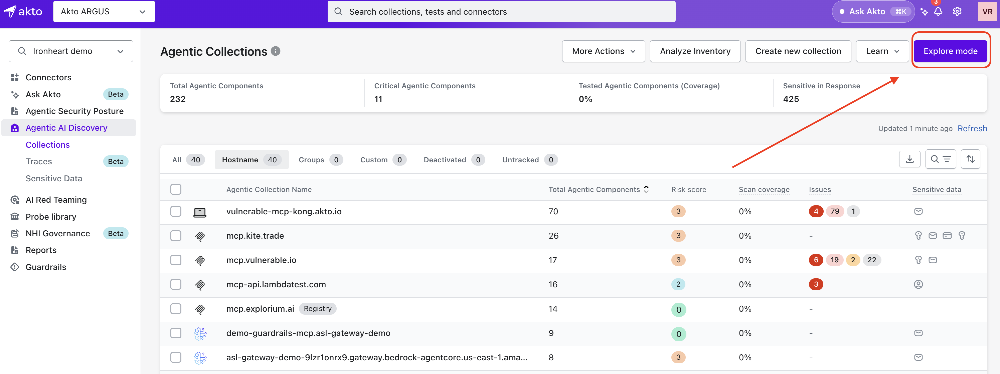
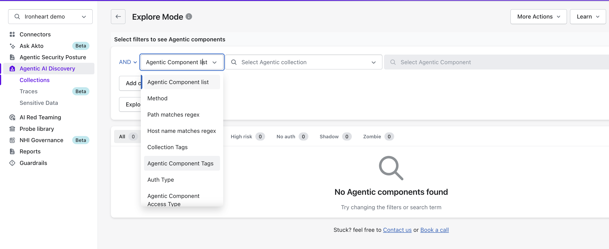
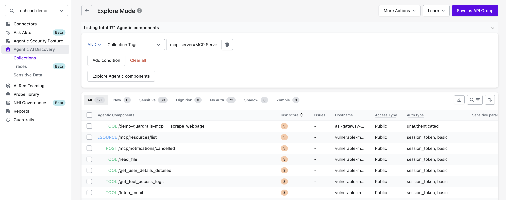

# Explore Mode

Explore Mode lets you browse and filter the agentic components in your inventory, then save the filtered results as a collection. You can use it to find specific components across hosts and to group them for targeted AI Red Teaming.

## Where to find Explore Mode

In the Akto dashboard, go to **Agentic AI Discovery** > **Collections** and click **Explore mode** at the top right of the **Agentic Collections** page.

<figure><figcaption>Click <strong>Explore mode</strong> on the <strong>Collections</strong> page to open it.</figcaption></figure>

## Filtering agentic components

Explore Mode opens with the prompt **Select filters to see Agentic components** and shows no results until you run a search. Each filter is a condition in a row, and rows are combined with **AND**.



Open the filter type dropdown, which shows **Agentic Component list** by default, and select the attribute to filter on.

<figure><figcaption>Select a filter type from the dropdown.</figcaption></figure>




Set the filter value. For the default filter type, use **Select Agentic collection** to limit results to a collection, then **Select Agentic Component** to pick specific components.



Click **Add condition** to add more filters. Click the trash icon to remove one condition, or **Clear all** to remove every condition.



Click **Explore Agentic components** to run the search.



### Available filter types

| Filter type | What it matches |
| --- | --- |
| **Agentic Component list** | Specific components, optionally within an Agentic collection |
| **Method** | HTTP method of the component endpoint |
| **Path matches regex** | Component paths that match a regular expression |
| **Host name matches regex** | Host names that match a regular expression |
| **Collection Tags** | Collections carrying the selected tag, for example `mcp-server=MCP Server` |
| **Agentic Component Tags** | Components carrying the selected tags |
| **Auth Type** | Authentication type of the component |
| **Agentic Component Access Type** | Access type of the component |

## Reading the results

After you click **Explore Agentic components**, the page shows **Listing total N Agentic components** and a results table.

<figure><figcaption>Review the filtered components, then click the button at the top right to save them as a group.</figcaption></figure>

The table includes these columns:

* **Agentic Components**: Component type (for example TOOL, RESOURCE) or HTTP method, with the component path
* **Risk score**
* **Issues**
* **Hostname**
* **Access Type**
* **Auth type**
* **Sensitive params**

### Quick views

Tabs above the table narrow the results to a category, each with a count:

* **All**
* **New**
* **Sensitive**
* **High risk**
* **No auth**
* **Shadow**
* **Zombie**

## Use cases

### Discovering shadow agents

Open the **Shadow** tab, or add an **Auth Type** condition and click **Explore Agentic components**, to surface components that run outside standard authentication. For more on how Akto classifies them, see [Shadow agents](shadow-agents.md).

### Finding unauthenticated or high-risk MCP servers

Open the **No auth** or **High risk** tab, then add **Agentic Component Access Type** to focus on publicly reachable components.

### Grouping components by host or path

Add **Host name matches regex** or **Path matches regex** conditions to collect components that share a host or path pattern, such as every endpoint of one framework or service.

### Reviewing stale components

Open the **Zombie** tab to list components that are no longer in active use. For more detail, see [Zombie agents](zombie-agents.md).

## Saving filtered results as a group

Click the button at the top right of Explore Mode to save a group from the components in the filtered results. The group appears in the **Groups** tab on the **Collections** page. You can then select the group as a target for [AI Red Teaming](../../agentic-red-teaming/README.md). For the full procedure, see [Add collection using Explore Mode](../how-to/add-collection-using-explore-mode.md).
