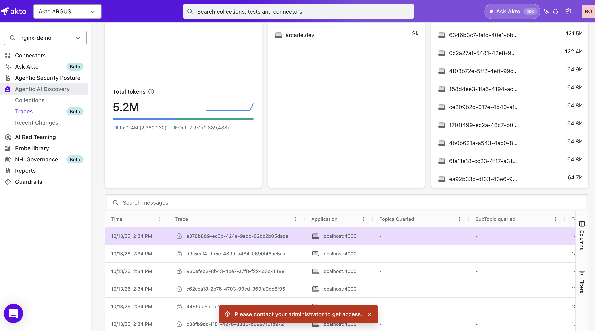

# Redact sensitive data

Akto redacts sensitive data in agent and MCP traffic automatically. There are no settings to enable and no redaction levels to choose.

Agent prompts and responses often contain PII and credentials. Automatic redaction lets your team review agent activity without exposing that data.

## Where Redaction Applies

| Where                  | What you see                                                                     |
| ---------------------- | -------------------------------------------------------------------------------- |
| **Guardrail Activity** | Data is always redacted, for everyone.                                           |
| **Traces**             | Admins see the full prompt, unredacted. Other users cannot open prompts.         |

## How Redaction Works

Akto detects sensitive values in requests and responses and replaces each one with `[REDACTED]`. Only the sensitive values are replaced. The rest of the content stays readable, so you can still follow what the agent did.

```
... delta3 echo4 foxtrot5 golf6 [REDACTED] papa15 alpha16 bravo17 ...
```

## Guardrail Activity

In **Guardrail Activity**, the **Evidence** column shows the flagged content with sensitive values redacted. Open an event to view its **Request** and **Response**, where detected values are also redacted. This applies to all users, including admins.

Redacted values appear as `[REDACTED]`, or as a labeled marker such as `[SSN_REDACTED]` when Akto identifies the type of data.

<div data-with-frame="true"><figure><figcaption></figcaption></figure></div>

<!-- Screenshot: Guardrail Activity event detail, Request/Response with redacted values -->

## Traces

Prompts in **Traces** can contain sensitive data, so access depends on your role:

* **Admin**: you can open a trace and see the full prompt, without redaction.
* **All other users**: you cannot open prompts. Traces show a lock icon, and opening one shows "Please contact your administrator to get access."

<!-- Screenshot: Traces view as admin (full data) -->

<div data-with-frame="true"><figure><figcaption></figcaption></figure></div>

## Important Notes

* Redaction is automatic. You do not need to configure it.
* Admins can see full prompts in **Traces**, so give the admin role only to people who are allowed to view sensitive data.
* The same admin sees `[REDACTED]` in **Guardrail Activity** and the full prompt in **Traces**.
