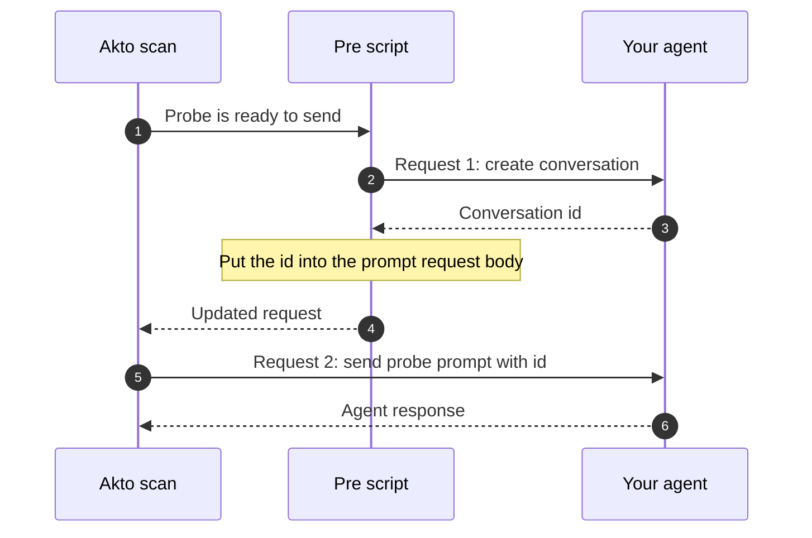
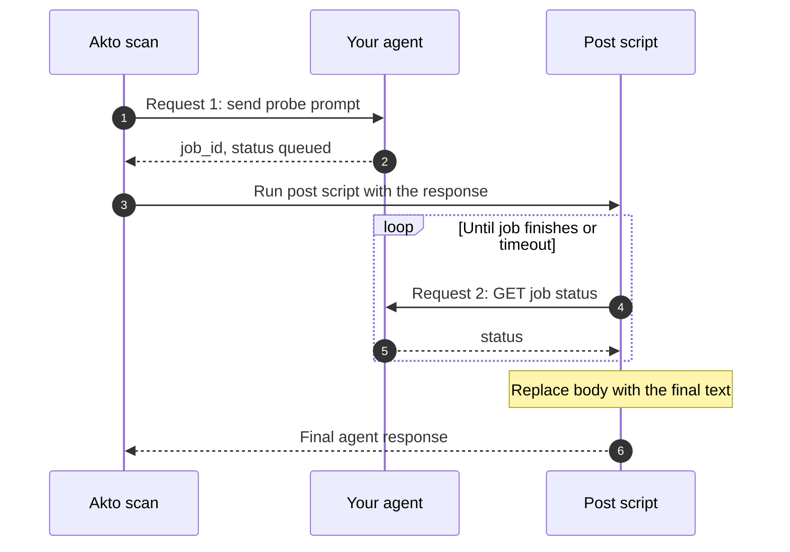

# Configure Pre and Post Request Scripts

Some agents cannot be probed with a single request. They need a setup call first (for example, creating a conversation or session), or a follow-up call afterwards (for example, fetching the response). Pre and post request scripts let you run custom JavaScript around the request that carries the probe prompt, so Akto can complete the full sequence for every probe.

## When to use which script

Look at where your agent expects the prompt in its two-request flow:

| Your agent's flow                                                                                       | Use              | Why                                                                                          |
| ------------------------------------------------------------------------------------------------------- | ---------------- | -------------------------------------------------------------------------------------------- |
| Request 1 sets things up (creates a conversation or session). Request 2 carries the prompt.             | **Pre script**   | The script makes request 1 first, then puts the returned value (such as an id) into the prompt request. |
| Request 1 carries the prompt. Request 2 is needed afterwards (for example, to retrieve the response).   | **Post script**  | The script makes the follow-up call after the prompt request has been sent, then returns the final response to Akto. |


If your agent accepts the prompt in one standalone request, you do not need either script. The scripts are only for multi-request flows or for adjusting requests dynamically.


## Add a script



Go to **User Config**.



Enter your JavaScript in the **pre-request** or **post-request** script text area (for example, "Enter pre-request javascript here..."). Each script type has its own section below with the variables it can use and an example.



Click **Save** to apply your changes.




The script runs for every probe request, so limit it to the requests it is meant for. Check `url` at the start of the script and skip the rest if it does not match, as the example below does.


## Pre-request script

The pre-request script runs **before** the probe request is sent. Use it to make a setup call and put the result into the probe request, or to change the request itself. Assign a new value to a variable to change what Akto sends. For example, assigning a new value to `payload` changes the request body.

### Pre-request script variables

| Variable      | Description                                       |
| ------------- | ------------------------------------------------- |
| `method`      | The HTTP method of the request (e.g., GET, POST). |
| `headers`     | The headers of the request.                       |
| `url`         | The URL of the request.                           |
| `payload`     | The body of the request.                          |
| `queryParams` | The query parameters of the request.              |

### Example: create a conversation, then send the prompt

This pre script is for an agent that works in two requests:

1. `POST https://agent.example.com/api/conversations` creates a conversation and returns `{ "data": { "id": "..." }, "status": "success" }`.
2. `POST https://agent.example.com/api/chat` sends the prompt, and the body must contain that conversation `id`.

The script runs only for the chat request. It calls the create endpoint, reads the id from the response, and writes it into the probe request body.



<details>

<summary>Pre script example</summary>

```javascript
// PRE_REQUEST: create a conversation, then put its id into the request body
// Applies only to: https://agent.example.com/api/chat
//
// What this script does, for every probe request:
//   1. Checks the request URL. If it is not the chat request, it does nothing.
//   2. Calls the "create conversation" endpoint and reads the new conversation id.
//   3. Writes that id into the probe request body, so the prompt is sent inside a valid conversation.

// Variables Akto provides to the script. Declare the ones you use.
// Changing a variable (for example `payload`) changes the request Akto sends.
var method;       // HTTP method of the probe request
var headers;      // headers of the probe request
var url;          // URL of the probe request
var payload;      // body of the probe request
var queryParams;  // query parameters of the probe request
var parsedPayloadTemp;
var cachedUrl;

var executeOncePerConversation = false;

// ---------------- config: change these values for your agent ----------------
// Matches only the request that carries the probe prompt (here: .../api/chat).
// The pattern also allows an optional trailing slash and query string.
var TARGET_URL_REGEX = /\/api\/chat\/?(?:[?#]|$)/i;

// The endpoint that creates a conversation, and the body it expects.
var CREATE_CONVERSATION_URL = "https://agent.example.com/api/conversations";
var CREATE_CONVERSATION_BODY = {
    "user_id": "akto-scan-user"
};

// How long to wait for the create call before giving up, in milliseconds.
var HTTP_TIMEOUT_MS = 15000;
// ------------------------------------------------------------------------------

// Returns true if this request is the one the script should act on.
function isTargetUrl(requestUrl) {
    return requestUrl != null && TARGET_URL_REGEX.test(String(requestUrl));
}

// Returns true for null, undefined, or empty/whitespace-only values.
function isBlank(value) {
    return value == null || String(value).trim().length === 0;
}

// Reads a Java input stream (an HTTP response body) into a string, line by line.
function readStream(stream) {
    var text = "";
    if (stream != null) {
        var BufferedReader = Java.type("java.io.BufferedReader");
        var InputStreamReader = Java.type("java.io.InputStreamReader");
        var reader = new BufferedReader(new InputStreamReader(stream, "UTF-8"));
        var line;
        while ((line = reader.readLine()) !== null) {
            text += line + "\n";
        }
        reader.close();
    }
    return text;
}

// Sends a POST request with a JSON body and returns { code, text }:
// the HTTP status code and the response body as a string.
function postApiCall(targetUrl, jsonData) {
    var URL = Java.type("java.net.URL");
    var BufferedWriter = Java.type("java.io.BufferedWriter");
    var OutputStreamWriter = Java.type("java.io.OutputStreamWriter");

    var connection = new URL(targetUrl).openConnection();
    connection.setRequestMethod("POST");
    connection.setConnectTimeout(HTTP_TIMEOUT_MS);
    connection.setReadTimeout(HTTP_TIMEOUT_MS);
    connection.setRequestProperty("Content-Type", "application/json");
    connection.setRequestProperty("Accept", "application/json");
    // Add any auth header your create endpoint needs, for example:
    // connection.setRequestProperty("Authorization", "Bearer <token>");
    connection.setDoOutput(true);

    // Write the JSON body.
    var outputStream = connection.getOutputStream();
    var writer = new BufferedWriter(new OutputStreamWriter(outputStream, "UTF-8"));
    writer.write(JSON.stringify(jsonData));
    writer.flush();
    writer.close();
    outputStream.close();

    // Read the response. Error responses (400 and above) come from the error stream.
    var code = connection.getResponseCode();
    var stream = code >= 400 ? connection.getErrorStream() : connection.getInputStream();
    return { code: Number(code), text: readStream(stream) };
}

// Calls the create endpoint and returns the new conversation id, or null on failure.
// Expected response shape: { "data": { "id": "..." }, "status": "success" }
// If your agent returns the id somewhere else, change the line that reads parsed.data.id.
function createConversationId() {
    var res = postApiCall(CREATE_CONVERSATION_URL, CREATE_CONVERSATION_BODY);
    if (res.code >= 400) {
        print("pre-script: create conversation failed: http", res.code, res.text.substring(0, 200));
        return null;
    }
    var parsed = JSON.parse(res.text.trim());
    var id = (parsed != null && parsed.data != null) ? parsed.data.id : null;
    return isBlank(id) ? null : String(id);
}

// Sets the "id" field of the probe request body to the new conversation id.
// If your agent expects the id in a different field, change obj.id.
function replaceIdInPayload(newId) {
    var obj = typeof payload === "string" ? JSON.parse(payload) : JSON.parse(JSON.stringify(payload));
    obj.id = newId;
    payload = JSON.stringify(obj);   // assigning to payload changes the body Akto sends
}

// Main flow. print(...) writes to the scan logs, which helps when debugging.
try {
    if (!isTargetUrl(url)) {
        // Not the chat request: leave it untouched.
        print("pre-script: url does not match TARGET_URL_REGEX, skipping:", url);
    } else if (isBlank(payload)) {
        print("pre-script: empty payload, nothing to replace");
    } else {
        var conversationId = createConversationId();
        if (conversationId != null) {
            replaceIdInPayload(conversationId);
            print("pre-script: payload.id replaced with", conversationId);
        }
        // If the create call failed, the request is sent unchanged.
    }
} catch (e) {
    print("pre-script error:", e);
}
```

</details>

#### Adapt the example to your agent

Change only the values in the `config` block:

| Setting                    | What to change                                                                                           |
| -------------------------- | -------------------------------------------------------------------------------------------------------- |
| `TARGET_URL_REGEX`         | A pattern that matches only the request that carries the probe prompt.                                   |
| `CREATE_CONVERSATION_URL`  | The endpoint that creates the conversation or session.                                                   |
| `CREATE_CONVERSATION_BODY` | The body that endpoint expects.                                                                          |
| `HTTP_TIMEOUT_MS`          | How long to wait for the create call, in milliseconds.                                                   |

If the id has a different name or location, update `createConversationId` (where the id is read from the response) and `replaceIdInPayload` (where it is written into the probe request).


Use `print(...)` to log what the script is doing, as the example does. If a probe fails, these messages show whether the script skipped the request, the create call failed, or the id was replaced.



## Post-request script

The post-request script runs **after** the probe request has been sent and the response is received. Use it when the response to the probe is not the final answer, for example when the agent returns a job id and you need a follow-up call to retrieve the real response. Assign a new value to `body` to change the response Akto evaluates.

### Post-request script variables

| Variable    | Description                                                                                           |
| ----------- | ----------------------------------------------------------------------------------------------------- |
| `statusCode` | The HTTP status code of the prompt request's response.                                               |
| `body`      | The response body of the prompt request. Assign a new value to replace the response Akto evaluates.   |
| `headers`   | The headers available to the script. The example copies them onto the polling request (for example, a session cookie or auth header). |
| `url`       | The URL of the prompt request.                                                                        |
| `payload`   | The body of the prompt request.                                                                       |

### Example: poll for the final response

Some agents answer a prompt asynchronously. The prompt request only returns a job id, and the real answer is available from a second endpoint once the job finishes. Without a post script, Akto would evaluate the "job accepted" message instead of the agent's answer.

This post script is for an agent that works in two requests:

1. `POST https://agent.example.com/api/ask` sends the prompt and returns `{ "job_id": "...", "status": "queued" }`.
2. `GET https://agent.example.com/api/ask/{job_id}` returns the job status, and once finished, `{ "status": "succeeded", "response": { "text": "..." } }`.

The script runs only for the prompt request. It reads the job id from the response, polls the second endpoint until the job finishes, and replaces the response `body` with the agent's final text.



<details>

<summary>Post script example</summary>

```javascript
// POST_REQUEST: poll for the final response, then replace the body with it
// Applies only to: https://agent.example.com/api/ask
//
// What this script does, for every probe request:
//   1. Checks the request URL. If it is not the prompt request, it does nothing.
//   2. Reads the job id from the response of the prompt request.
//   3. Polls the job status endpoint until the job finishes or the wait time runs out.
//   4. Replaces the response body with the agent's final text, so Akto evaluates the real answer.

// Variables Akto provides to the script. Declare the ones you use.
var statusCode;  // HTTP status code of the prompt request's response
var headers;     // headers available to the script (copied onto the polling request below)
var body;        // response body of the prompt request. Assign a new value to replace it.
var url;         // URL of the prompt request
var payload;     // body of the prompt request

// ---------------- config: change these values for your agent ----------------
// Matches only the request that carries the probe prompt (here: .../api/ask).
var SUBMIT_URL_REGEX = /\/api\/ask\/?(?:[?#]|$)/i;

// The status endpoint. The job id is appended to this prefix.
var POLL_URL_PREFIX = "https://agent.example.com/api/ask/";

// Status values that mean the job is finished (including failure states).
var TERMINAL_STATUSES = ["succeeded", "failed", "cancelled", "error"];

var POLL_INTERVAL_MS = 500;     // pause between polls
var MAX_WAIT_MS = 60000;        // give up after this long and return a timeout message
var CONNECT_TIMEOUT_MS = 10000; // how long to wait to connect
var READ_TIMEOUT_MS = 15000;    // how long a single poll can wait for a reply

// Headers that are not copied onto the polling request, because the HTTP client
// sets them itself or they describe the original request body.
var SKIP_HEADERS = ["host", "content-length", "content-type", "connection",
    "transfer-encoding", "accept-encoding", "expect", "upgrade", "via"];
// ------------------------------------------------------------------------------

// Returns true for null, undefined, or empty/whitespace-only values.
function isBlank(value) {
    return value == null || String(value).trim().length === 0;
}

// Builds the headers for the polling request by copying the headers Akto gave the script,
// so the poll is authenticated the same way (for example, same session cookie or token).
function buildPollHeaders() {
    var out = {};
    if (headers != null) {
        var it = headers.entrySet().iterator();
        while (it.hasNext()) {
            var e = it.next();
            var name = String(e.getKey());
            var value = e.getValue();
            // A header can have several values. Join them into one string.
            if (value instanceof java.util.Collection) {
                var parts = [];
                var vi = value.iterator();
                while (vi.hasNext()) { parts.push(String(vi.next())); }
                value = parts.join(name.toLowerCase() === "cookie" ? "; " : ", ");
            }
            if (value != null && SKIP_HEADERS.indexOf(name.toLowerCase()) < 0) {
                out[name] = String(value);
            }
        }
    }
    out["Accept"] = "application/json";
    return out;
}

// Sends a GET request and returns { code, text }:
// the HTTP status code and the response body as a string.
function httpGet(target, requestHeaders) {
    var conn = new java.net.URL(target).openConnection();
    conn.setRequestMethod("GET");
    conn.setConnectTimeout(CONNECT_TIMEOUT_MS);
    conn.setReadTimeout(READ_TIMEOUT_MS);
    for (var name in requestHeaders) {
        conn.setRequestProperty(name, String(requestHeaders[name]));
    }
    // Error responses (400 and above) come from the error stream.
    var code = conn.getResponseCode();
    var stream = code >= 400 ? conn.getErrorStream() : conn.getInputStream();
    var text = "";
    if (stream != null) {
        var reader = new java.io.BufferedReader(new java.io.InputStreamReader(stream, "UTF-8"));
        var line;
        while ((line = reader.readLine()) != null) { text += line + "\n"; }
        reader.close();
    }
    return { code: Number(code), text: text };
}

// Polls the job status endpoint until the job reaches a finished status or MAX_WAIT_MS passes.
// Returns the text that should become the new response body.
// Expected response shape when finished: { "status": "succeeded", "response": { "text": "..." } }
// If your agent returns the answer somewhere else, change the line that reads parsed.response.text.
function pollUntilDone(pollUrl, pollHeaders) {
    var started = java.lang.System.currentTimeMillis();
    var attempts = 0;

    while (java.lang.System.currentTimeMillis() - started < MAX_WAIT_MS) {
        attempts++;
        var res = httpGet(pollUrl, pollHeaders);

        // A client error (for example 401 or 404) will not fix itself, so stop polling.
        if (res.code >= 300 && res.code < 500) {
            return "poll failed: http " + res.code;
        }

        var parsed = null;
        try { parsed = JSON.parse(res.text); } catch (e) {
            print("post-script: attempt", attempts, "non-JSON, http=", res.code);
        }

        // Finished: return the final text (or the status if there is no text).
        if (parsed != null && TERMINAL_STATUSES.indexOf(String(parsed.status).toLowerCase()) >= 0) {
            print("post-script: done after", attempts, "attempt(s), status=", parsed.status);
            if (parsed.response != null && !isBlank(parsed.response.text)) {
                return String(parsed.response.text);
            }
            return "status=" + parsed.status;
        }

        // Not finished yet: wait, then poll again.
        java.lang.Thread.sleep(POLL_INTERVAL_MS);
    }
    return "timed out after " + MAX_WAIT_MS + "ms";
}

// Main flow. print(...) writes to the scan logs, which helps when debugging.
try {
    if (!SUBMIT_URL_REGEX.test(String(url))) {
        // Not the prompt request: leave the response untouched.
        print("post-script: url does not match SUBMIT_URL_REGEX, skipping:", url);
    } else if (isBlank(body)) {
        print("post-script: empty body");
    } else {
        // The prompt request's response is the "job accepted" message, e.g. { "job_id": "...", "status": "queued" }.
        var submitted = JSON.parse(String(body));
        if (isBlank(submitted.job_id)) {
            print("post-script: no job_id in response");
        } else {
            var pollUrl = POLL_URL_PREFIX + String(submitted.job_id);
            // Replace the response body with the agent's final answer.
            body = pollUntilDone(pollUrl, buildPollHeaders());
        }
    }
} catch (e) {
    print("post-script error:", e);
    body = "post-script error: " + e;
}
```

</details>

#### Adapt the example to your agent

| Setting                           | What to change                                                                                   |
| --------------------------------- | ------------------------------------------------------------------------------------------------ |
| `SUBMIT_URL_REGEX`                | A pattern that matches only the request that carries the probe prompt.                           |
| `POLL_URL_PREFIX`                 | The endpoint you poll. The job id is appended to it.                                             |
| `TERMINAL_STATUSES`               | The status values your agent uses when a job is finished, including failure states.              |
| `POLL_INTERVAL_MS`                | How often to poll, in milliseconds.                                                              |
| `MAX_WAIT_MS`                     | The longest the script waits for the job. When it expires, `body` contains a timeout message.    |
| `READ_TIMEOUT_MS`                 | How long a single poll can wait for a reply. Raise it if your endpoint holds the request open until the job is done. |

If your agent names the job id or the answer differently, update the lines that read `submitted.job_id` and `parsed.response.text`. If your agent streams the answer in chunks, collect the chunks on each poll and join them once the job is done.


The example reuses the headers from the prompt request so the polling call is authenticated the same way. If your agent needs a different token for the status endpoint, set it in `buildPollHeaders`.



Keep `MAX_WAIT_MS` finite. A script that never returns holds up the scan, and the scan stops when **Scan run time** expires.


You can use both scripts together. For example, a pre script creates the conversation and a post script polls for the answer.

## Usage notes

* Scripts apply to the probes of the scans you run after saving.
* Scripts can add authentication tokens, modify request data, or call other endpoints before or after the probe request.
* Be cautious when modifying core request properties, as it may affect the intended behavior of your scans.
* For complex operations, break your code into functions for readability and maintenance.
* Keep credentials out of the script where possible. Prefer a [scan role](create-a-test-role.md) for authentication.

