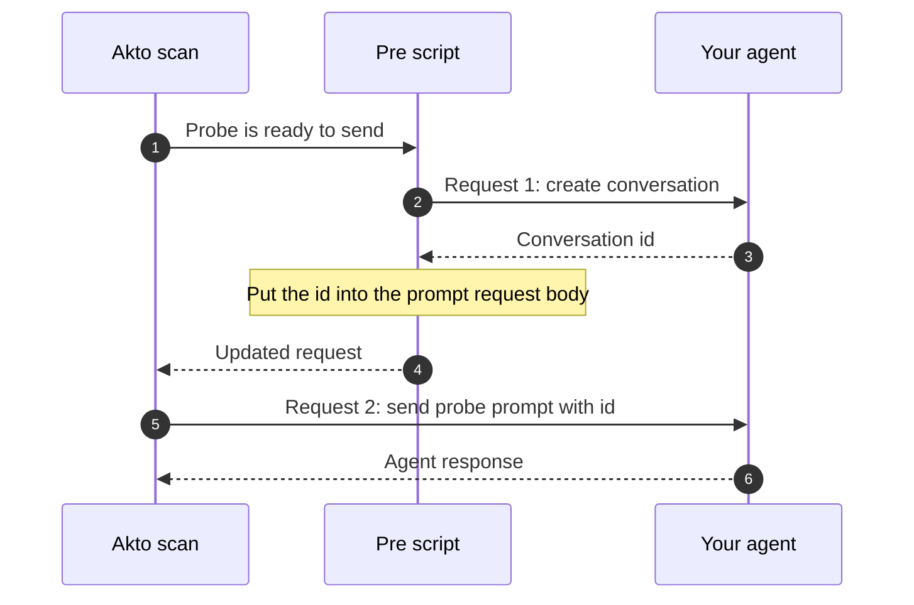

# Configure Pre and Post Request Scripts

Some agents cannot be probed with a single request. They need a setup call first (for example, creating a conversation or session), or a follow-up call afterwards (for example, fetching the response). Pre and post request scripts let you run custom JavaScript around the request that carries the probe prompt, so Akto can complete the full sequence for every probe.



## When to use which script

Look at where your agent expects the prompt in its two-request flow:

| Your agent's flow                                                                                       | Use              | Why                                                                                          |
| ------------------------------------------------------------------------------------------------------- | ---------------- | -------------------------------------------------------------------------------------------- |
| Request 1 sets things up (creates a conversation or session). Request 2 carries the prompt.             | **Pre script**   | The script makes request 1 first, then puts the returned value (such as an id) into the prompt request. |
| Request 1 carries the prompt. Request 2 is needed afterwards (for example, to retrieve the response).   | **Post script**  | The script makes the follow-up call after the prompt request has been sent.                  |




If your agent accepts the prompt in one standalone request, you do not need either script. The scripts are only for multi-request flows or for adjusting requests dynamically.


## Set up a script



Go to **User Config**.



In the script text area (for example, "Enter pre-request javascript here..."), enter your JavaScript.

The script has access to these predefined variables:

| Variable      | Description                         |
| ------------- | ----------------------------------- |
| `method`      | The HTTP method of the request (e.g., GET, POST). |
| `headers`     | The headers of the request.         |
| `url`         | The URL of the request.             |
| `payload`     | The body of the request.            |
| `queryParams` | The query parameters of the request. |

Change a variable inside the script to change what Akto sends. For example, assigning a new value to `payload` changes the request body.



Click **Save** to apply your changes.

<figure><figcaption></figcaption></figure>




The script runs for every probe request, so limit it to the requests it is meant for. Check `url` at the start of the script and skip the rest if it does not match, as the example below does.


## Example: create a conversation, then send the prompt

This pre script is for an agent that works in two requests:

1. `POST https://agent.example.com/api/conversations` creates a conversation and returns `{ "data": { "id": "..." }, "status": "success" }`.
2. `POST https://agent.example.com/api/chat` sends the prompt, and the body must contain that conversation `id`.

The script runs only for the chat request. It calls the create endpoint, reads the id from the response, and writes it into the probe request body.

```javascript
// PRE_REQUEST: create a conversation, then put its id into the request body
// Applies only to: https://agent.example.com/api/chat

var method;
var headers;
var url;
var payload;
var queryParams;
var parsedPayloadTemp;
var cachedUrl;

var executeOncePerConversation = false;

// ---------------- config ----------------
var TARGET_URL_REGEX = /\/api\/chat\/?(?:[?#]|$)/i;

var CREATE_CONVERSATION_URL = "https://agent.example.com/api/conversations";
var CREATE_CONVERSATION_BODY = {
    "user_id": "akto-scan-user"
};
var HTTP_TIMEOUT_MS = 15000;
// -----------------------------------------

function isTargetUrl(requestUrl) {
    return requestUrl != null && TARGET_URL_REGEX.test(String(requestUrl));
}

function isBlank(value) {
    return value == null || String(value).trim().length === 0;
}

function readStream(stream) {
    var text = "";
    if (stream != null) {
        var BufferedReader = Java.type("java.io.BufferedReader");
        var InputStreamReader = Java.type("java.io.InputStreamReader");
        var reader = new BufferedReader(new InputStreamReader(stream, "UTF-8"));
        var line;
        while ((line = reader.readLine()) !== null) {
            text += line + "\n";
        }
        reader.close();
    }
    return text;
}

function postApiCall(targetUrl, jsonData) {
    var URL = Java.type("java.net.URL");
    var BufferedWriter = Java.type("java.io.BufferedWriter");
    var OutputStreamWriter = Java.type("java.io.OutputStreamWriter");

    var connection = new URL(targetUrl).openConnection();
    connection.setRequestMethod("POST");
    connection.setConnectTimeout(HTTP_TIMEOUT_MS);
    connection.setReadTimeout(HTTP_TIMEOUT_MS);
    connection.setRequestProperty("Content-Type", "application/json");
    connection.setRequestProperty("Accept", "application/json");
    // Add any auth header your create endpoint needs, for example:
    // connection.setRequestProperty("Authorization", "Bearer <token>");
    connection.setDoOutput(true);

    var outputStream = connection.getOutputStream();
    var writer = new BufferedWriter(new OutputStreamWriter(outputStream, "UTF-8"));
    writer.write(JSON.stringify(jsonData));
    writer.flush();
    writer.close();
    outputStream.close();

    var code = connection.getResponseCode();
    var stream = code >= 400 ? connection.getErrorStream() : connection.getInputStream();
    return { code: Number(code), text: readStream(stream) };
}

function createConversationId() {
    var res = postApiCall(CREATE_CONVERSATION_URL, CREATE_CONVERSATION_BODY);
    if (res.code >= 400) {
        print("pre-script: create conversation failed: http", res.code, res.text.substring(0, 200));
        return null;
    }
    var parsed = JSON.parse(res.text.trim());
    var id = (parsed != null && parsed.data != null) ? parsed.data.id : null;
    return isBlank(id) ? null : String(id);
}

function replaceIdInPayload(newId) {
    var obj = typeof payload === "string" ? JSON.parse(payload) : JSON.parse(JSON.stringify(payload));
    obj.id = newId;
    payload = JSON.stringify(obj);
}

try {
    if (!isTargetUrl(url)) {
        print("pre-script: url does not match TARGET_URL_REGEX, skipping:", url);
    } else if (isBlank(payload)) {
        print("pre-script: empty payload, nothing to replace");
    } else {
        var conversationId = createConversationId();
        if (conversationId != null) {
            replaceIdInPayload(conversationId);
            print("pre-script: payload.id replaced with", conversationId);
        }
    }
} catch (e) {
    print("pre-script error:", e);
}
```

### Adapt the example to your agent

Change only the values in the `config` block:

| Setting                    | What to change                                                                                           |
| -------------------------- | -------------------------------------------------------------------------------------------------------- |
| `TARGET_URL_REGEX`         | A pattern that matches only the request that carries the probe prompt.                                   |
| `CREATE_CONVERSATION_URL`  | The endpoint that creates the conversation or session.                                                   |
| `CREATE_CONVERSATION_BODY` | The body that endpoint expects.                                                                          |
| `HTTP_TIMEOUT_MS`          | How long to wait for the create call, in milliseconds.                                                   |

If the id has a different name or location, update `createConversationId` (where the id is read from the response) and `replaceIdInPayload` (where it is written into the probe request).


Use `print(...)` to log what the script is doing, as the example does. If a probe fails, these messages show whether the script skipped the request, the create call failed, or the id was replaced.


## Post script

Use a post script when the prompt request comes first and a second call is needed to finish the exchange. Configure it from **User Config** the same way as the pre script, and use the same `url` check so it runs only for the prompt request.

## Usage notes

* Scripts apply to the probes of the scans you run after saving.
* Scripts can add authentication tokens, modify request data, or call other endpoints before or after the probe request.
* Be cautious when modifying core request properties, as it may affect the intended behavior of your scans.
* For complex operations, break your code into functions for readability and maintenance.
* Keep credentials out of the script where possible. Prefer a [scan role](create-a-test-role.md) for authentication.
