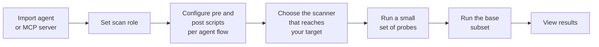

# Run Scan

A scan runs security probes against an agent or MCP server you have imported into Akto. Complete the prerequisites below first, then configure and run the scan.

## Prerequisites

### Import the agent or MCP server

A scan can only run on an asset that exists in a collection. If you have not imported yours yet, do that first:

* [AI Agent Import](../get-started/manual-import/ai-agent-import.md)
* [MCP Import](../get-started/manual-import/mcp-import.md)

Once imported, the asset appears under **Agentic AI Discovery > Collections**.

### Set the scan role

The scan role holds the authentication Akto uses when it sends probe requests to your agent or MCP server (hard-coded token, token from traffic, automated token generation, TLS or digest auth). It is also what lets you probe from the point of view of different privilege levels.

Create the role before you run the scan so you can select it in the **Select Scan Role** field. See [Create a Scan Role](create-a-test-role.md) for setup, and [Scan Roles](../concepts/test-role.md) for the concept.


If your agent or MCP server needs no authentication, you can leave **Select Scan Role** empty.



**MCP servers: `MCP_AUTHENTICATION_ROLE`**

* `MCP_AUTHENTICATION_ROLE` is the only default scan role for an MCP server. **Select Scan Role** selects it by default when you scan an MCP server.
* The role takes only two headers: `authorization` and `sseCallBackUrl`.
* If you have multiple MCP servers, update the values of `MCP_AUTHENTICATION_ROLE` before you run the scan on each server. You do not create a role per server.
* If you do not update the values, the scan can fail.

See [Set Up the Default Scan Role for MCP Scans](../get-started/manual-import/mcp-import.md#set-up-the-default-scan-role-for-mcp-scans) for the header values.


### Configure pre and post scripts

Pre and post request scripts are part of red teaming. Configure them based on your agent's flow. A pre script runs a setup call first (for example, creating a conversation) and passes its result into the prompt request. A post script runs a follow-up call after the prompt request (for example, polling for the final response). Scripts are configured under **User Config**, not in the Configure scan window, and they apply to the scans you run afterwards.

See [Configure Pre and Post Request Scripts](configure-pre-request-script.md).

### Choose the scanner that can reach your target

Your agent or MCP server is either internal (not reachable from the public internet, or behind a firewall, WAF or private network) or external (publicly reachable). The scanner you select in **Select Testing Module(s)** must be able to reach the target.

| Target       | Who sets up the scanner and model                                                                                                                                                         |
| ------------ | ------------------------------------------------------------------------------------------------------------------------------------------------------------------------------------------ |
| **Internal** | You deploy the scanning module in your own system ([Install Scanning module in your Cloud](install-testing-module-in-your-cloud/README.md)), and set up your own model under **Settings > Integrations > Agent configuration**, with **Name** set to `red-teaming`. |
| **External** | Akto provides the model key and runs the testing modules in the Akto cloud. You leave the default module selected.                                                                        |

## Run the scan



**Open the Configure scan window**

1. Go to **Agentic AI Discovery > Collections**.
2. Open the collection that contains your agent or MCP server.
3. Click **Run scan**.

<figure><figcaption></figcaption></figure>




**Choose what to scan**

* **Name**: Akto fills this in from the target and the selected probes. Rename it so you can find the run later in the results. Click **Clear selection** to reset the probe selection and start from nothing.
* **Test Categories** (left panel): groups of probes such as Model Context Protocol (MCP) Security, MCP - Indirect Prompt Injection, Agentic Supply Chain, Agent Goal Hijack, and Cascading Failures. Each category shows how many of its probes are selected. Click a category to see its probes.
* **Tests** (right panel): the individual probes in the selected category. Use the checkbox at the top to select or deselect all, **More filters** and the search icon to narrow the list. Probes you or your org created carry a **Custom** tag.
* **Probes selected** (bottom of the window): live count of probes in the current selection.


A larger selection takes longer and consumes more tokens. For a first scan, pick the categories that match what your asset does (for an MCP server, start with the MCP categories) instead of selecting everything.


<figure><figcaption></figcaption></figure>




**Set the run options**

| Field                        | What it does                                                                                       | How to set it                                                                                                                                                                         |
| ---------------------------- | -------------------------------------------------------------------------------------------------- | ------------------------------------------------------------------------------------------------------------------------------------------------------------------------------------- |
| **Run Type**                 | Runs the scan **Once** or on a recurring schedule.                                                 | Use **Once** for a first scan or an ad hoc check. Use a recurring option for regular validation. The footer button label follows this choice (for example **Run once now**).          |
| **Select date**              | Day the scan starts.                                                                               | Defaults to today. Change it only to schedule for later.                                                                                                                              |
| **Select Time**              | Time the scan starts.                                                                              | **Now** starts immediately. Pick a time to run off-hours.                                                                                                                             |
| **Scan run time**            | Maximum duration of the scan. The scan stops automatically when it expires.                        | Default is 30 minutes. Large selections (thousands of probes) may not finish in 30 minutes, so increase it, or reduce the selection.                                                  |
| **Select Scan Role**         | Scan role whose authentication is used for probe requests.                                         | Pick the role you set up in the prerequisites. For an MCP server, `MCP_AUTHENTICATION_ROLE` is selected by default. **No test role selected** means requests go out without role-based auth.      |
| **Max Concurrent Requests**  | Number of probe requests sent in parallel.                                                         | Leave on **Default** unless needed. Higher values finish faster but put more load on your agent. Lower it if the target is rate limited or is a production system.                    |
| **Max Agent Tokens**         | Upper limit on tokens the agent can consume during the scan.                                       | **No limit** places no cap. Set a limit if your agent calls a paid LLM and you want to bound cost.                                                                                    |
| **Select Testing Module(s)** | Which module (engine) executes the scan.                                                           | Leave the default module for publicly reachable targets. For internal agents or MCP servers, select the module deployed in your own environment (see the warning below). See [Scanning Module Selector in Akto](testing-module-selector-in-akto.md).                      |


**Internal agents and MCP servers**

For an internal target, choose your internally deployed module in **Select Testing Module(s)**. The default Akto-hosted module cannot reach internal targets, so the scan would fail to connect. See [Choose the scanner that can reach your target](#choose-the-scanner-that-can-reach-your-target) for setup, and [Scanning Module Selector in Akto](testing-module-selector-in-akto.md) to select the module.

For an external target, leave the default module selected and Akto uses the active scanning module automatically.



Probes send adversarial requests to your agent, and each one can trigger LLM calls and tool executions. When scanning a production agent, start with a low **Max Concurrent Requests** and a **Max Agent Tokens** limit.


<figure><figcaption></figcaption></figure>




**Choose post-scan options (optional)**

* **Slack integration to send alerts post completion**: sends a notification to a Slack channel when the scan finishes. If the checkbox is greyed out, click **Enable** to connect the integration first.
* **Microsoft Teams integration to send alerts post completion**: sends a notification to a Microsoft Teams channel when the scan finishes. If the checkbox is greyed out, click **Enable** to connect the integration first.
* **Auto-create tickets**: opens tickets for issues the scan finds. See [Auto-Create Jira Tickets](auto-create-jira-tickets.md).
* **Use different target for scanning**: sends the scan to a target other than the one associated with the collection, for example a staging copy of the agent.
* **Mark issues as fixed if they don't show up again**: closes previously reported issues that no longer reproduce in the run. Enabled by default.
* **Smart Automated Testing**: lets Akto adapt scan execution automatically instead of running the fixed selection as-is.

<figure><figcaption></figcaption></figure>




**Add advanced configurations (optional)**

Click **Show advance configurations** to add custom headers or conditions to the scan's requests.

* Choose **Add Header**, enter a key and value, and use **Add condition** to chain multiple headers with **AND** or **OR** logic.

Custom headers suit agent-specific request requirements, such as a tenant or account header.

<figure><figcaption></figcaption></figure>




**Start the scan**

Click **Run once now** (the label follows the selected **Run Type**, for example **Schedule scan** for scheduled runs).

Results appear under **AI Red Teaming > Results**. To end a scan early, see [Stop Scan](stop-tests.md).


After the run, open the scan under **AI Red Teaming > Results** to review findings, or use **Edit Scan settings** there to adjust and re-run. See [Edit Probe Settings](edit-test-settings.md).




## Recommended scan order



**Run a small set of probes**

Select a few probes, set **Run Type** to **Once** and **Select Time** to **Now**, and run the scan. Open the scan under **AI Red Teaming > Results** and confirm the run succeeds. If the run fails, check the errors and fix the configuration using [Fix a failed scan](#fix-a-failed-scan).



**Run the base subset of probes**

Select the base categories for your target (for an MCP server, the MCP categories) and run the scan. Selecting **All** probes takes a long time to complete and consumes more tokens. If the selection is large, raise **Scan run time** from the 30-minute default.



## Fix a failed scan

| Symptom                                 | Where to fix                                                                                                                                  |
| --------------------------------------- | --------------------------------------------------------------------------------------------------------------------------------------------- |
| The scan cannot connect to your target  | **Select Testing Module(s)**: an internal target needs the scanning module deployed in your own system.                                       |
| Authentication errors                   | The scan role: its headers and token. For an MCP server, update the `authorization` and `sseCallBackUrl` values of `MCP_AUTHENTICATION_ROLE`. |
| Wrong or empty responses                | The import (request body and headers) and the [pre and post request scripts](configure-pre-request-script.md).                                |
