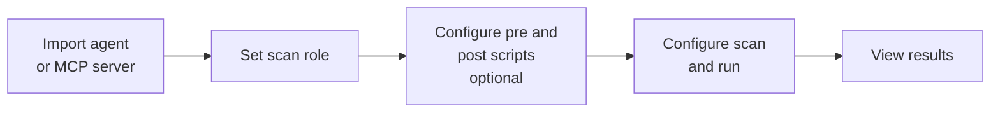

# Run Scan

A scan runs security probes against an agent or MCP server you have imported into Akto. Complete the prerequisites below first, then configure and run the scan.

## Prerequisites

### Import the agent or MCP server

A scan can only run on an asset that exists in a collection. If you have not imported yours yet, do that first:

* [AI Agent Import](../get-started/manual-import/ai-agent-import.md)
* [MCP Import](../get-started/manual-import/mcp-import.md)

Once imported, the asset appears under **Agentic AI Discovery > Collections**.

### Set the scan role

The scan role holds the authentication Akto uses when it sends probe requests to your agent or MCP server (hard-coded token, token from traffic, automated token generation, TLS or digest auth). It is also what lets you probe from the point of view of different privilege levels.

Create the role before you run the scan so you can select it in the **Select Scan Role** field. See [Create a Scan Role](create-a-test-role.md) for setup, and [Scan Roles](../concepts/test-role.md) for the concept.


If your agent or MCP server needs no authentication, you can leave **Select Scan Role** empty.


### Configure pre and post scripts (optional)

Use scripts when your agent needs more than one request per probe. A pre script runs a setup call first (for example, creating a conversation) and passes its result into the prompt request. A post script runs a follow-up call after the prompt request. Scripts are configured under **User Config**, not in the Configure scan window, and they apply to the scans you run afterwards.

See [Configure Pre and Post Request Scripts](configure-pre-request-script.md).

## Run the scan



**Open the Configure scan window**

1. Go to **Agentic AI Discovery > Collections**.
2. Open the collection that contains your agent or MCP server.
3. Click **Run scan**.

<figure><figcaption></figcaption></figure>




**Choose what to scan**

* **Name**: Akto fills this in from the target and the selected probes. Rename it so you can find the run later in the results. Click **Clear selection** to reset the probe selection and start from nothing.
* **Test Categories** (left panel): groups of probes such as Model Context Protocol (MCP) Security, MCP - Indirect Prompt Injection, Agentic Supply Chain, Agent Goal Hijack, and Cascading Failures. Each category shows how many of its probes are selected. Click a category to see its probes.
* **Tests** (right panel): the individual probes in the selected category. Use the checkbox at the top to select or deselect all, **More filters** and the search icon to narrow the list. Probes you or your org created carry a **Custom** tag.
* **Probes selected** (bottom of the window): live count of probes in the current selection.


A larger selection takes longer and consumes more tokens. For a first scan, pick the categories that match what your asset does (for an MCP server, start with the MCP categories) instead of selecting everything.


<figure><figcaption></figcaption></figure>




**Set the run options**

| Field                        | What it does                                                                                       | How to set it                                                                                                                                                                         |
| ---------------------------- | -------------------------------------------------------------------------------------------------- | ------------------------------------------------------------------------------------------------------------------------------------------------------------------------------------- |
| **Run Type**                 | Runs the scan **Once** or on a recurring schedule.                                                 | Use **Once** for a first scan or an ad hoc check. Use a recurring option for regular validation. The footer button label follows this choice (for example **Run once now**).          |
| **Select date**              | Day the scan starts.                                                                               | Defaults to today. Change it only to schedule for later.                                                                                                                              |
| **Select Time**              | Time the scan starts.                                                                              | **Now** starts immediately. Pick a time to run off-hours.                                                                                                                             |
| **Scan run time**            | Maximum duration of the scan. The scan stops automatically when it expires.                        | Default is 30 minutes. Large selections (thousands of probes) may not finish in 30 minutes, so increase it, or reduce the selection.                                                  |
| **Select Scan Role**         | Scan role whose authentication is used for probe requests.                                         | Pick the role you set up in the prerequisites. **No test role selected** means requests go out without role-based auth.                                                                          |
| **Max Concurrent Requests**  | Number of probe requests sent in parallel.                                                         | Leave on **Default** unless needed. Higher values finish faster but put more load on your agent. Lower it if the target is rate limited or is a production system.                    |
| **Max Agent Tokens**         | Upper limit on tokens the agent can consume during the scan.                                       | **No limit** places no cap. Set a limit if your agent calls a paid LLM and you want to bound cost.                                                                                    |
| **Select Testing Module(s)** | Which module (engine) executes the scan.                                                           | Leave the default module unless you run your own, for example one inside your cloud. See [Scanning Module Selector in Akto](testing-module-selector-in-akto.md).                      |


Not sure which module to pick? Leave the default selected and Akto uses the active scanning module automatically.



Probes send adversarial requests to your agent, and each one can trigger LLM calls and tool executions. When scanning a production agent, start with a low **Max Concurrent Requests** and a **Max Agent Tokens** limit.


<figure><figcaption></figcaption></figure>




**Choose post-scan options (optional)**

* **Slack integration to send alerts post completion**: sends a notification to a Slack channel when the scan finishes. If the checkbox is greyed out, click **Enable** to connect the integration first.
* **Microsoft Teams integration to send alerts post completion**: same, for Microsoft Teams. Click **Enable** to connect it if it is greyed out.
* **Auto-create tickets**: opens tickets for issues the scan finds. See [Auto-Create Jira Tickets](auto-create-jira-tickets.md).
* **Use different target for scanning**: sends this scan to a target other than the one associated with the collection, for example a staging copy of the agent.
* **Mark issues as fixed if they don't show up again**: closes previously reported issues that no longer reproduce in this run. Enabled by default.
* **Smart Automated Testing**: lets Akto adapt scan execution automatically instead of running the fixed selection as-is.

<figure><figcaption></figcaption></figure>




**Add advanced configurations (optional)**

Click **Show advance configurations** to add custom headers or conditions to the scan's requests.

* Choose **Add Header**, enter a key and value, and use **Add condition** to chain multiple headers with **AND** or **OR** logic.

This is useful for agent-specific request requirements, such as a tenant or account header.

<figure><figcaption></figcaption></figure>




**Start the scan**

Click **Run once now** (the label follows the selected **Run Type**, for example **Schedule scan** for scheduled runs).

Results appear under **AI Red Teaming > Results**. To end a scan early, see [Stop Scan](stop-tests.md).


After the run, open the scan under **AI Red Teaming > Results** to review findings, or use **Edit Scan settings** there to adjust and re-run. See [Edit Probe Settings](edit-test-settings.md).



