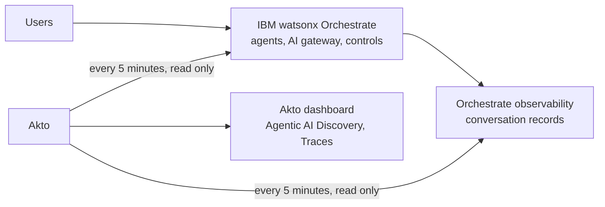
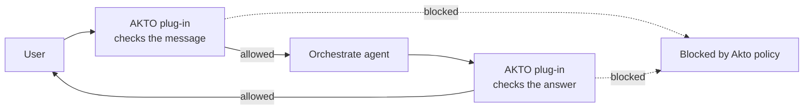

# IBM watsonx Orchestrate

## Overview

IBM watsonx Orchestrate is IBM's platform for building, running and governing AI agents. It acts as an agent control plane: it manages agents built in Orchestrate and external agents, an AI gateway for models and MCP servers, guardrail controls, connections to business systems, and agent permissions.

Akto connects to your Orchestrate instance with an API key and, every few minutes:

* **Discovers** everything Orchestrate manages: your agents (built in Orchestrate and external agents), their tools, collaborators, models, MCP servers, guardrail controls, connections, identity and permissions.
* **Reads the conversations** your agents have had, as recorded by Orchestrate's observability, and sends them to Akto for security analysis.

Nothing is installed in your IBM account and your agents are not changed. Akto only reads. Conversations reach Akto a few minutes after they happen.

## How it works



## What Akto Covers

### Agents

| Covered | Details |
|---|---|
| **Agents built in Orchestrate** | All agents, both **draft** and **live** (deployed). For live agents, Akto reads the deployed version, so you see what is actually running. |
| **External agents** | Agents registered in Orchestrate's **Agent directory** (external chat and A2A agents built on other frameworks). |
| **Multi-agent setups** | Supervisor agents and their **collaborators**, including external collaborators. Each conversation shows which agent called which. |
| **IBM built-in agents** | Agents such as AskOrchestrate and the Document Processing agent, if used in your instance. |

Each agent appears in Akto under its **display name** as shown in Orchestrate (for external agents, their title).

### What Akto discovers about each agent

| Area | What you see in Akto |
|---|---|
| **Configuration** | Description, instructions, model, tools, collaborators, MCP servers, knowledge bases, plug-ins, and whether the agent is in draft, live or both |
| **AI gateway** | The models available in your instance, and MCP servers registered on the gateway with their tools |
| **Controls (guardrails)** | Which Orchestrate controls (PII filter, content guardrails, rate limiters, code plug-ins and others) are applied to the agent, its tools and its model. Agents with **no controls** are flagged |
| **Connections** | The business systems the agent connects to (for example SAP SuccessFactors), with their authentication type and whether they are shared by the team or set per user. Only names and types are read |
| **Identity and permissions** | Who created the agent and when, who last updated it and when, whether agent identity is enabled, the permissions granted through its connections, and the number of tools it can access (including through collaborators) |

### Conversation traffic

| Covered | Details |
|---|---|
| **User messages and agent answers** | Every conversation turn, in draft (preview) and live |
| **System prompt** | The instructions the agent runs with |
| **Tool calls** | Each tool the agent called, with its input and result |
| **Collaborator handoffs** | When a supervisor delegates to a collaborator (including external agents), both sides of the handoff, linked together |
| **Flow inputs** | Messages and form choices a user sends to a running flow (for example a document processing flow), labelled as flow input |
| **Model and token usage** | The model used and input/output tokens per turn |
| **User and session** | Who sent the message, and the conversation session it belongs to |

Conversation content is sent to Akto as Orchestrate records it, including the user who sent each message.

## Prerequisites

* An **IBM watsonx Orchestrate** SaaS instance (IBM Cloud or AWS hosted).
* An **Orchestrate API key** for a user who can see all agents. We recommend a dedicated user with the **Admin** role, so that controls, connections and permissions are fully visible.
* Your **Akto data ingestion service URL** (contact Akto support if you don't have it).

## Steps to Connect



**Get your Orchestrate instance URL and API key**

1. Sign in to watsonx Orchestrate.
2. Open your profile menu (top right) → **Settings** → **API details**.
3. Copy the **Service instance URL**. For example:\
   `https://api.dl.watson-orchestrate.ibm.com/instances/<instance-id>`
4. Click **Generate API key**, give it a name (for example `akto-monitoring`) and copy the key. It is shown only once.


IBM API keys can expire. Note the expiry date and update the key in Akto before it expires.




**Add the connector in Akto**

1. In the Akto dashboard, go to **Connectors** → **AI Agent Security** → **IBM watsonx Orchestrate**.
2. Fill in the form:

| Field | Required | Value |
|---|---|---|
| **Instance URL** | Yes | The Service instance URL from the previous step |
| **API Key** | Yes | The Orchestrate API key from the previous step |
| **URL for Data Ingestion Service** | Yes | Your Akto data ingestion service URL |

3. Click **Import**.

<!-- Screenshot of the IBM watsonx Orchestrate connector form: to be added once the form is available in the dashboard. -->



**Wait for the first sync**

Akto starts right away and then repeats every **5 minutes**:

* Your agents, models, MCP servers, controls and connections appear within a few minutes.
* The conversations of the **last 3 days** are imported. For a busy instance this can take a few cycles.
* After that, new conversations appear in Akto **5 to 10 minutes** after they happen.



**See your agents in Akto**

1. Go to **Agentic AI Discovery** → **Collections**. You will find:
   * one collection per agent, named after the agent (for example *Customer Support Agent*);
   * one collection per MCP server registered on the AI gateway;
   * a **watsonx Orchestrate AI Gateway** collection listing models, MCP servers, controls and connections.
2. Open a collection to see its tags, for example:

| Tag | Example |
|---|---|
| `bot-name` | Customer Support Agent |
| `tools` | get_order_status |
| `collaborators` | Billing Agent, Currency Agent |
| `mcp-servers` | wxo_ootb_docproc |
| `controls` | PII Filter, or `none` when no control is applied |
| `connections` | SAP SuccessFactors (team) |
| `created-by` / `updated-by` | the creator and the last editor |
| `agent-identity` | enabled or disabled |
| `environments` | draft, live |

3. Go to **Agentic AI Discovery** → **Traces** to read the conversations: user prompt, agent response, tool calls, tokens and session.



## Data Handling

* **Read only.** Akto only reads from Orchestrate. It does not create, change or delete agents, tools, controls or connections.
* **Dedicated access.** Create the Orchestrate access for Akto under a dedicated user, so it can be reviewed and revoked on its own.
* **Connections.** Akto reads only the names and types of the connections configured in Orchestrate.

## Troubleshooting

| Symptom | What to check |
|---|---|
| No agents appear | The instance URL is the **Service instance URL** (it contains `/instances/`) |
| Agents appear but no conversations | Conversations exist on Orchestrate's **Observability** page for that period. Only the last 3 days are imported on the first run |
| Controls or connections are missing | Use a user with the **Admin** role in Orchestrate |
| New conversations appear late | Conversations are read every 5 minutes. Allow up to 10 minutes |

## Real-time Blocking

Real-time blocking adds the **AKTO plug-in** to your Orchestrate agents. On every conversation turn:

* the **user's message** is checked by your AKTO guardrail policies **before the agent processes it**;
* the **agent's answer** is checked **before the user sees it**.

A message or answer that violates a policy is **blocked**. If a policy masks content (for example personal data), the agent or the user receives the masked version. Every checked exchange is also recorded in Akto.



### How it behaves

| | |
|---|---|
| **Blocked message** | The agent does not process it, and Orchestrate reports the block in the chat |
| **Blocked answer** | The answer is not shown to the user |
| **Masked content** | The masked version is passed on instead of the original |
| **Monitor-only policies** | Policies set to warn or alert are recorded in Akto but do not block |
| **Added wait** | Each message and answer waits for Akto's verdict, at most 5 seconds |


### Prerequisites

* Your **AKTO guardrail policies** set up in the Akto dashboard.
* Your **AKTO guardrails host** and **AKTO API key** (**AKTO Argus** → **Connectors** → **Setup Guardrails**).
* An **Orchestrate API key** of a user with the **Admin** role (Orchestrate → profile menu → **Settings** → **API details**), and the **Service instance URL** shown on the same page.
* For the installer: **Python 3.11 to 3.14** on the computer you run it from ([python.org/downloads](https://www.python.org/downloads/)).

### Method 1: Installer (all Orchestrate plans)

The installer adds the AKTO plug-in to the agents you choose. You do not need to install anything else: it prepares IBM's tools by itself, in a folder of its own.



**Download the AKTO plug-in package**

Download the package [akto-watsonx-1.0.0.zip](https://akto-watsonx-connector.s3.us-east-1.amazonaws.com/ibm_watsonx/1.0.0/akto-watsonx-1.0.0.zip) and unzip it. Its checksum is published next to it as [akto-watsonx-1.0.0.zip.sha256](https://akto-watsonx-connector.s3.us-east-1.amazonaws.com/ibm_watsonx/1.0.0/akto-watsonx-1.0.0.zip.sha256). The folder contains the installer, the plug-in and a checksum file; the installer checks the files before using them.



**Run the installer**

Unzipping creates a folder named `akto-watsonx-1.0.0`. For example, if you downloaded it to your **Downloads** folder:

```
Downloads/
└── akto-watsonx-1.0.0/
    ├── akto_watsonx_setup.py     the installer
    ├── akto_guard.py             the AKTO plug-in
    ├── requirements.txt
    ├── SHA256SUMS
    └── README.md
```

Open a terminal and go to that folder. Use the path where you unzipped it:

```bash
cd ~/Downloads/akto-watsonx-1.0.0
```


On macOS, you can also type `cd ` (with a space) in the terminal and drag the `akto-watsonx-1.0.0` folder from Finder into the terminal window, then press **Enter**.


Then run the installer from that folder:

```bash
python3 akto_watsonx_setup.py install \
  --instance-url "<Service instance URL>" \
  --akto-host "<AKTO guardrails host>" \
  --agents all --deploy
```

**Choose which agents to protect** with `--agents`:

| To protect | Use |
|---|---|
| One agent | `--agents "Customer Support Agent"` |
| Several agents | `--agents "Customer Support Agent, Billing Agent"` |
| All agents | `--agents all` |

* Use the agent's name as shown in Orchestrate (its display name or its internal name; upper and lower case do not matter).
* `--agents all` covers every agent that exists when you run the installer. **Agents created later are not added automatically**: run the installer again with the new agent's name (or with `all`). Agents that already have the plug-in are left as they are.
* External agents cannot have plug-ins in Orchestrate; they are protected through the Orchestrate agent that calls them.

`--deploy` also updates your **live** agents. Without it, only the **draft** agents are protected, so you can test in the agent's preview first. Agents that are not live (draft only) are never deployed by the installer.

When asked, paste your Orchestrate API key and your AKTO API key. Nothing is shown while you paste.



**Check the summary**

The installer ends with the list of your agents and whether each one is protected in draft and live:

```
==> AKTO plug-in status
    installed in Orchestrate: v1.0.0

    Agent                                      Draft          Live
    Customer Support Agent                     protected      protected
    Billing Agent                              protected      protected
```

If an agent's draft has other changes that were never deployed, the installer asks before deploying it, because deploying would publish those changes too.



### Method 2: Orchestrate UI (Premium plans)

On Orchestrate plans with **dedicated deployment** (Premium), the AKTO plug-in can be added to agents from the Orchestrate UI, as a control. Contact the Akto team to set up the AKTO plug-in for your instance, then:

1. In Orchestrate, go to **Controls** → **Create Control**.
2. Select **Code plugin** → **Next**.
3. Name the control (for example `akto-guardrails`), choose **Use existing Python toolkit** and select the **AKTO guardrails** toolkit.
4. In **Assign Assets**, select the agents to protect.
5. **Review** → **Create**.


On other plans, Orchestrate does not offer adding code plug-ins from the UI; use the installer (Method 1).


### Check that it works

1. Open one of the protected agents in Orchestrate and send an ordinary message: the agent answers as usual.
2. Send a message that one of your AKTO guardrail policies blocks: the agent does not answer it.
3. In Akto, the blocked message appears under the agent, in **Agentic AI Discovery** → **Traces**.

### Update or remove the plug-in

Go to the unzipped folder first (for example `cd ~/Downloads/akto-watsonx-1.0.0`), then run:

| To | Run |
|---|---|
| See which agents are protected | `python3 akto_watsonx_setup.py status --instance-url "<URL>"` |
| Install a newer version (from a newer package) | `python3 akto_watsonx_setup.py upgrade --instance-url "<URL>" --deploy` |
| Remove the plug-in | `python3 akto_watsonx_setup.py uninstall --instance-url "<URL>" --agents all --deploy` |

Removing it from all agents also removes the AKTO plug-in and its settings from your Orchestrate instance.

## Get Support for your Akto setup

There are multiple ways to request support from Akto. We are 24X7 available on the following:

1. In-app `intercom` support. Message us with your query on intercom in Akto dashboard and someone will reply.
2. Join our [discord channel](https://www.akto.io/community) for community support.
3. Contact `help@akto.io` for email support.
4. Contact us [here](https://www.akto.io/contact-us).
