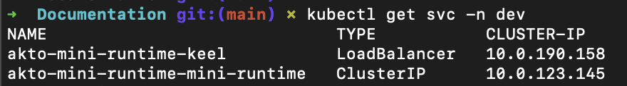
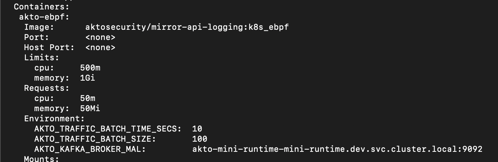

# Connect Akto with Hybrid SaaS

## Getting API Token



Go to [app.akto.io](https://app.akto.io).



Login/Signup into your account.



Click on **Connectors** in the left nav.



Open the **Setup Guardrail** card and copy your token from there.



## Installing Traffic connector

You can use either a CloudFormation template, Terraform template, a Helm chart or a Linux VM to install Traffic aggregator in your env. Each method below also includes an optional step to enable redaction for traces.

### Terraform



**Install the mini-runtime**

Use the Terraform script [here](https://github.com/akto-api-security/infra/blob/mini_runtime_tf_script/templates/mini-runtime.tf).

* Please make sure you install it in a private subnet from your application VPC.
* This private subnet should also have network connectivity (typically via NAT).



**Set the Akto inputs**

You can use `https://cyborg.akto.io` as `DatabaseAbstractorUrl`. For `DatabaseAbstractorToken`, refer to the [Getting API Token](#getting-api-token) section above.



**Enable redaction for traces (optional)**

Add the environment variables to the mini-runtime to redact sensitive data in stored traces. See [Enabling redaction for traces](#enabling-redaction-for-traces).



**Copy the output**

Once complete, copy `akto_nlb_dns` from the output.



**Install a traffic connector**

Use the above copied `AktoNLBIP` as `AKTO_KAFKA_BROKER_MAL` in your traffic connectors. Note that `AKTO_KAFKA_BROKER_MAL` is inclusive of port (eg `akto-N-.....amazonaws.com:9092`).



### CloudFormation template



**Install the mini-runtime**

Run the CloudFormation template [here](https://raw.githubusercontent.com/akto-api-security/infra/feature/quick-setup/templates/mini-runtime.yml).

* Please make sure you install it in a private subnet from your application VPC.
* This private subnet should also have network connectivity (typically via NAT).



**Set the Akto inputs**

You can use `https://cyborg.akto.io` as `DatabaseAbstractorUrl`. For `DatabaseAbstractorToken`, refer to the [Getting API Token](#getting-api-token) section above.



**Enable redaction for traces (optional)**

Add the environment variables to the mini-runtime to redact sensitive data in stored traces. See [Enabling redaction for traces](#enabling-redaction-for-traces).



**Copy the output**

Once complete, go to the **Output** section of CloudFormation Stack and copy `AktoNLBIP`.



**Install a traffic connector**

Use the above copied `AktoNLBIP` as `AKTO_KAFKA_BROKER_MAL` in your traffic connectors. Note that `AKTO_KAFKA_BROKER_MAL` is inclusive of port (eg `akto-N-.....amazonaws.com:9092`).



### Helm chart



**Add the Akto helm repository**

If you have K8s clusters, you can use helm chart to install Traffic aggregator.

```bash
helm repo add akto https://akto-api-security.github.io/helm-charts/
```



**Install the akto-mini-runtime helm chart**

Install it in your kubernetes cluster using one of the following options.

1. Directly using database abstractor token

```bash
helm install akto-mini-runtime akto/akto-mini-runtime -n <your-namespace> --set mini_runtime.aktoApiSecurityRuntime.env.databaseAbstractorToken="<your-database-abstractor-token>"
```

2. Storing the database abstractor token in a secret

```bash
helm install akto-mini-runtime akto/akto-mini-runtime -n <your-namespace> --set mini_runtime.aktoApiSecurityRuntime.env.useSecretsForDatabaseAbstractorToken=true --set mini_runtime.aktoApiSecurityRuntime.env.databaseAbstractorTokenSecrets.token="<your-database-abstractor-token>"
```

3. Bring your own secret which has the database abstractor token

```bash
helm install akto-mini-runtime akto/akto-mini-runtime -n <your-namespace> --set mini_runtime.aktoApiSecurityRuntime.env.useSecretsForDatabaseAbstractorToken=true --set mini_runtime.aktoApiSecurityRuntime.env.databaseAbstractorTokenSecrets.existingSecret=<my-secret>
```

Running the above commands in your k8s cluster will deploy a new Akto Traffic aggregator service.



**Enable redaction for traces (optional)**

Add the environment variables to the mini-runtime pods to redact sensitive data in stored traces. See [Enabling redaction for traces](#enabling-redaction-for-traces).



**Copy the Traffic aggregator service address**

Run the below command and copy the `CLUSTER-IP` and `PORT` value for Traffic aggregator service. In the below example it will be `10.0.23.145:9092`. You can also use the kubernetes service ip, which in this case will be `akto-mini-runtime-mini-runtime.dev.svc.cluster.local:9092`

```bash
kubectl get svc -n <namespace>
```

<figure><figcaption></figcaption></figure>



**Install a traffic connector**

Use the above copied `IP:PORT` value as `AKTO_KAFKA_BROKER_MAL` in your traffic connectors. Note that `AKTO_KAFKA_BROKER_MAL` is inclusive of port (eg `10.0.23.145:9092`, `akto-mini-runtime-mini-runtime.dev.svc.cluster.local:9092`)

<figure><figcaption></figcaption></figure>



### Linux VM



**Create a new instance with the following requirements**

* Platform: Amazon Linux 2023
* Spec: 2 vCPU, 4GB RAM, 20GB Hard disk. Don't use burstable instances.
* Network: Private subnet, connectivity to internet (typically via NAT), connectivity to your staging service.
* Security groups: Inbound, open ports 22 and 9092. Outbound, open all.



**SSH into the instance**

SSH into this new instance in your Cloud and run `sudo su -`.



**Install Docker**

Install [docker](https://github.com/akto-api-security/infra/blob/feature/quick-setup/get-docker.sh) and [docker-compose](https://github.com/akto-api-security/infra/blob/feature/quick-setup/get-docker-compose.sh).



**Download the setup files**

```
wget https://raw.githubusercontent.com/akto-api-security/infra/refs/heads/feature/quick-setup/docker-compose-mini-runtime.yml
wget https://raw.githubusercontent.com/akto-api-security/infra/refs/heads/feature/quick-setup/watchtower.env
wget https://raw.githubusercontent.com/akto-api-security/infra/refs/heads/feature/quick-setup/docker-mini-runtime.env
wget https://raw.githubusercontent.com/akto-api-security/infra/refs/heads/feature/quick-setup/docker--detection.env
```



**Update the configuration**

* Modify ${AKTO\_KAFKA\_IP} in the `docker-compose-mini-runtime.yml` with the ip of your instance on which runtime will be deployed.
* Replace the value of `DATABASE_ABSTRACTOR_SERVICE_TOKEN` in `docker-mini-runtime.yml` with the token from the [Getting API Token](#getting-api-token) section above. Also replace the value of `AKTO_KAFKA_BROKER_URL` with \<instance\_ip>:9092.
* Also replace the value of `AKTO_THREAT_PROTECTION_BACKEND_TOKEN` and `DATABASE_ABSTRACTOR_SERVICE_TOKEN` in `docker-threat-detection.env` with the same token.



**Enable redaction for traces (optional)**

Add the environment variables to the mini-runtime configuration to redact sensitive data in stored traces. See [Enabling redaction for traces](#enabling-redaction-for-traces).



**Start the mini-runtime**

Run `docker-compose -f docker-compose-mini-runtime.yml up -d`



**Enable Docker on restart**

Run `systemctl enable /usr/lib/systemd/system/docker.service` to ensure Docker starts up in case of instance restarts.



## Enabling redaction for traces

Set the following environment variables on the mini-runtime to redact sensitive data in stored traces. For Helm deployments, they work the same way for the mini-runtime pods.


**Required environment variables**

* `AKTO_GUARDRAIL_REDACTION_ENABLED=true`
* `AKTO_GUARDRAIL_REDACTION_URL=http://<guardrails-service-http-host>:8080`

`AKTO_GUARDRAIL_REDACTION_URL` is the base URL of your guardrails service, without `/api`. There is deliberately no default value, so you must set it.


## Important Notes

1. Ensure internet connectivity in Traffic aggregator service.
2. In case of closed network, please whitelist (https://cyborg.akto.io)
3. Ensure that traffic connector is able to connect to Traffic aggregator service
4. Log levels for Akto services can be configured by setting the environment variable `AKTO_LOG_LEVEL`
   * Supported values include `TRACE`, `DEBUG`, `INFO`, `WARN`, `ERROR` and `OFF`.
   * Default log level is set to `WARN`.

## Get Support for your Akto setup

There are multiple ways to request support from Akto. We are 24X7 available on the following:

1. In-app `intercom` support. Message us with your query on intercom in Akto dashboard and someone will reply.
2. Join our [discord channel](https://www.akto.io/community) for community support.
3. Contact `help@akto.io` for email support.
4. Contact us [here](https://www.akto.io/contact-us).
