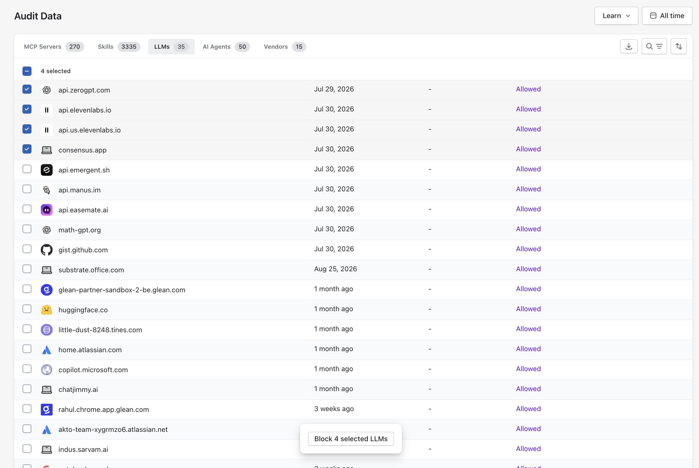
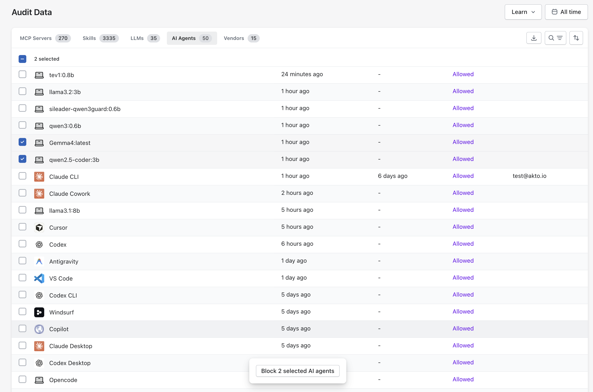
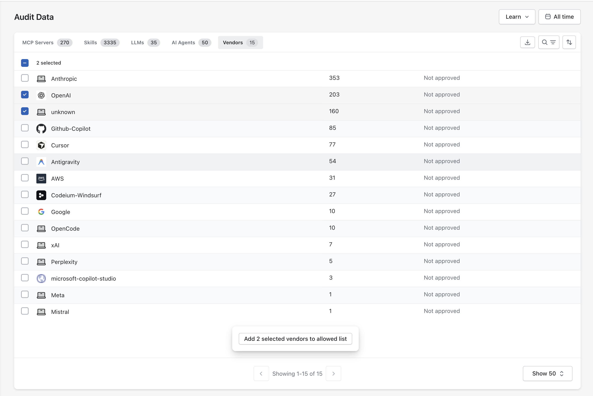
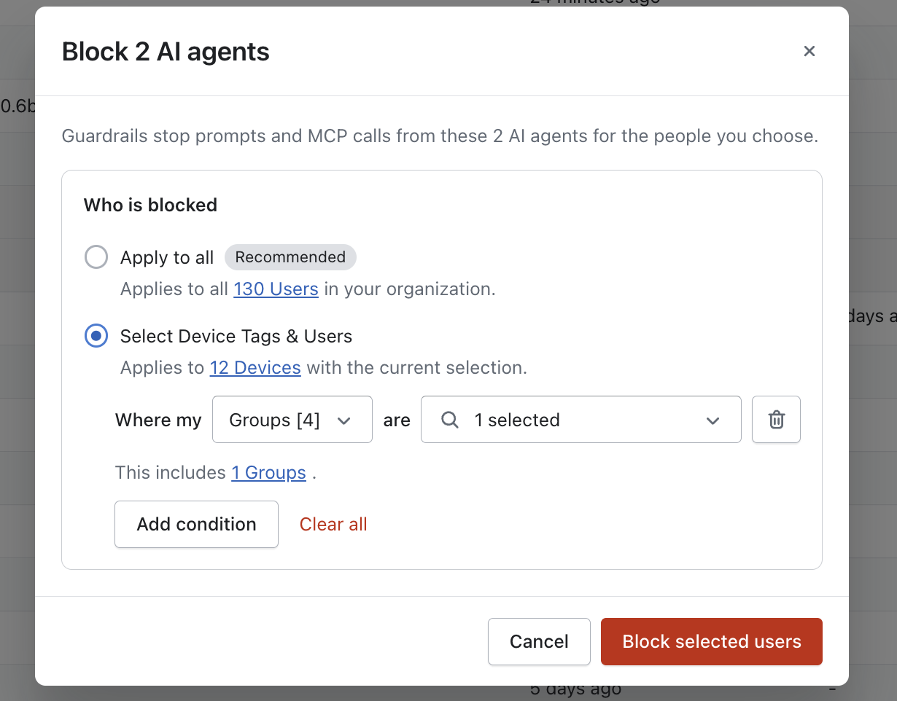

# Audit Data - Akto Atlas

## Overview

The **Audit Data** page in **Akto Atlas** shows you every MCP server, skill, LLM, AI agent, and vendor your employees use, and lets you **control how they're allowed to operate**.

From here, you can:

* See which MCP servers, skills, LLMs, AI agents, and vendors are being accessed.
* Inspect the tools, resources, and prompts exposed by each MCP server.
* Approve or block any of them, individually or in bulk.
* Scope any block to specific teams, devices, or users instead of blocking everyone.

## Explore Audit Data

Use the tabs at the top of the page to switch between **MCP Servers**, **Skills**, **LLMs**, **AI Agents**, and **Vendors**. Each tab shows a live count, and you can filter the time range with the **All time** dropdown at the top right.



Each row represents an MCP server and the agent that accesses it.

<figure><figcaption></figcaption></figure>

The table has the following columns:

<table><thead><tr><th width="147.92578125">Column</th><th>What it tells you</th></tr></thead><tbody><tr><td><strong>MCP Server</strong></td><td>The MCP server (domain or endpoint) being accessed</td></tr><tr><td><strong>AI Agent</strong></td><td>The agent accessing the server (e.g. VSCode, Claude, Cursor)</td></tr><tr><td><strong>Last Detected</strong></td><td>When the server was first observed in Atlas</td></tr><tr><td><strong>Updated</strong></td><td>Most recent activity for this server</td></tr><tr><td><strong>Access Type</strong></td><td>Type of access (e.g. public, private, third-party)</td></tr><tr><td><strong>Remarks</strong></td><td>Current decision: <strong>Approved</strong> or <strong>Rejected</strong>. A clock icon next to the remark means an <strong>Audit Pending</strong> re-review is due.</td></tr><tr><td><strong>Marked By</strong></td><td>Who last updated the decision</td></tr></tbody></table>


**Default Approval Behaviour**

* Without an [MCP registry integration](../../integrations/mcp-registry-integration.md) set up, every newly discovered MCP server defaults to **Approved**.
* Once you set up an [MCP registry integration](../../integrations/mcp-registry-integration.md), every newly discovered MCP server instead defaults to **Blocked**. From there, you can allow it for a specific agent (Cursor, Claude, and so on), or [add it to your MCP registry](audit-data-akto-atlas.md#action-dropdown), which gets it approved by default.


You can also act on a server directly from this table: hover a row to open its quick actions (**Allow this server**, **Block this server**, **Add to MCP registry**), without opening the full server details.



Each row represents a skill discovered on your employees' agentic tools.

<figure><figcaption></figcaption></figure>

<table><thead><tr><th width="147.92578125">Column</th><th>What it tells you</th></tr></thead><tbody><tr><td><strong>Skill</strong></td><td>The name of the skill</td></tr><tr><td><strong>Source</strong></td><td>The agent the skill was discovered on (e.g. codex, claude), or <strong>not-attached</strong> if it isn't tied to a specific agent</td></tr><tr><td><strong>Last Detected</strong></td><td>When the skill was first observed in Atlas</td></tr><tr><td><strong>Remarks</strong></td><td>Current decision: <strong>Allowed</strong> or <strong>Blocked</strong></td></tr><tr><td><strong>Marked By</strong></td><td>Who last updated the decision</td></tr></tbody></table>


**Bulk Blocking**

Select one or more skills using the checkboxes, then click **Block \<N> selected skills** from the action bar at the bottom of the table to block them all in one action.




The **LLMs** tab lists the LLM services your employees reach, shown by domain (for example chatgpt.com, claude.ai, perplexity.ai).

<figure><figcaption>Select LLMs and block them from the action bar.</figcaption></figure>

Each row shows when the LLM was last detected, its most recent activity, its current decision (for example **Allowed**), and who last updated the decision.

To block LLMs, select one or more rows using the checkboxes, then click **Block \<N> selected LLMs** from the action bar at the bottom of the table. Guardrails then stop prompts sent to the selected LLMs for the people you choose, as described in [Block for Specific Teams, Devices, or Users](audit-data-akto-atlas.md#block-for-specific-teams-devices-or-users).



The **AI Agents** tab lists the AI agents (for example Claude CLI, Claude Desktop, Cursor, Codex, VS Code, Windsurf) and local models (for example llama3.2:3b, qwen3:0.6b) detected across your employees' devices.

<figure><figcaption>Select AI agents and block them from the action bar.</figcaption></figure>

Each row shows when the agent was last detected, its most recent activity, its current decision (for example **Allowed**), and who last updated the decision.

To block agents, select one or more rows using the checkboxes, then click **Block \<N> selected AI agents** from the action bar at the bottom of the table. Guardrails then stop prompts and MCP calls from the selected agents for the people you choose, as described in [Block for Specific Teams, Devices, or Users](audit-data-akto-atlas.md#block-for-specific-teams-devices-or-users).



The **Vendors** tab lists the AI vendors (for example Anthropic, OpenAI, Google, AWS, GitHub Copilot) detected across your employees' devices.

<figure><figcaption>Select vendors and add them to the allowed list.</figcaption></figure>

Each row shows the vendor, a count of its activity, and its current status. Every vendor starts as **Not approved**.

To approve vendors, select one or more rows using the checkboxes, then click **Add \<N> selected vendors to allowed list** from the action bar at the bottom of the table.



### Block for Specific Teams, Devices, or Users

On every tab (**MCP Servers**, **Skills**, **LLMs**, **AI Agents**, and **Vendors**), you can limit a block to specific people instead of everyone. The block dialog asks **Who is blocked**:

<figure><figcaption>Choose who the block applies to, then add conditions to narrow the targets.</figcaption></figure>

* **Apply to all** (recommended): Blocks the selected items for every user in your organization. The dialog shows the user count.
* **Select Device Tags & Users**: Blocks the selected items only for the people you target. You build the rule as **Where my \<attribute> are \<value>**, and **Add condition** combines more than one rule. **Clear all** removes every condition.

You can target by:

| Attribute | Blocks it for                  |
| --------- | ------------------------------ |
| Groups    | Users in the selected groups   |
| Role      | Users with the selected roles  |
| Teams     | Users in the selected teams    |
| Users     | Individual users (**Beta**)    |

As you build the rule, the dialog shows how many devices the selection covers (for example, **Applies to 12 Devices**) and which groups it includes. Click **Block selected users** to enforce the rule.


**User targeting is in beta.** Targeting individual users is currently supported for browser extensions and Claude Desktop.


## View MCP Server Details

Click on any MCP server to view its details, including all tools, resources, and prompts it exposes.

<figure><figcaption></figcaption></figure>

### Capabilities

Each MCP server exposes capabilities used by agents. For each capability, you can see:

<table><thead><tr><th width="224.94921875">Field</th><th>What it tells you</th></tr></thead><tbody><tr><td><strong>Type</strong></td><td>Whether it's a Tool, Resource, or Prompt</td></tr><tr><td><strong>Risk Analysis</strong></td><td>Any risk signals like <strong>Privileged Access</strong> or <strong>Malicious</strong></td></tr><tr><td><strong>Name</strong></td><td>The identifier of the capability</td></tr><tr><td><strong>Access Types</strong></td><td>Whether the capability is public, private, or third-party</td></tr><tr><td><strong>Remarks</strong></td><td>Whether it's <strong>Approved</strong> or <strong>Rejected</strong></td></tr><tr><td><strong>Marked By</strong></td><td>Who made the decision</td></tr></tbody></table>

### Access Control Options

You can set access decisions at both the server level (via the Action dropdown) and the individual tool level. Use the following options:

<figure><figcaption></figcaption></figure>

#### **Allow**

Grant full access to the MCP server or specific tool. The agent can use all capabilities without restrictions.

#### **Block**

Deny access entirely. The agent cannot interact with this server or tool.

### Action Dropdown

From the **Action** dropdown at the top of the server details view, you can make server-level decisions:

* [**Allow this server**](audit-data-akto-atlas.md#allow) – Grant full access to all capabilities
* [**Block this server**](audit-data-akto-atlas.md#block) – Deny all access immediately for the particular AI Agent
* **Block for all agents** – Block this server across all agents in your organisation
*   **Add to MCP registry** – Register the server in your organisation's MCP registry

    
<figure><figcaption></figcaption></figure>


To use **Add to MCP registry**, you must first set up an [MCP registry integration](../../integrations/mcp-registry-integration.md) from **Settings → Integrations → MCP Registry**.

