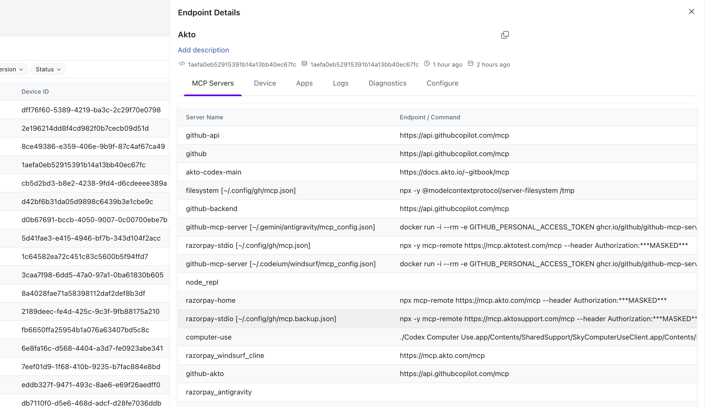
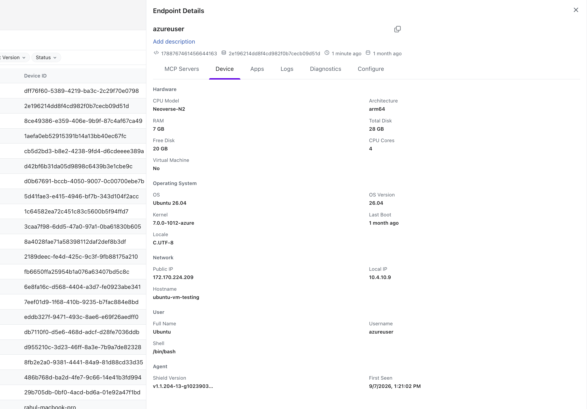
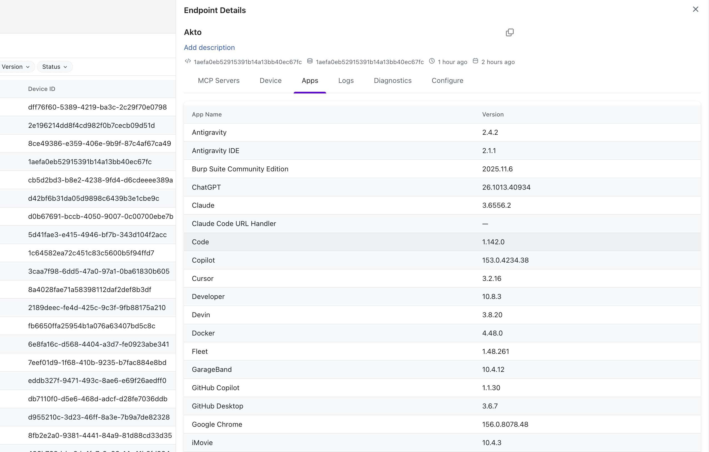
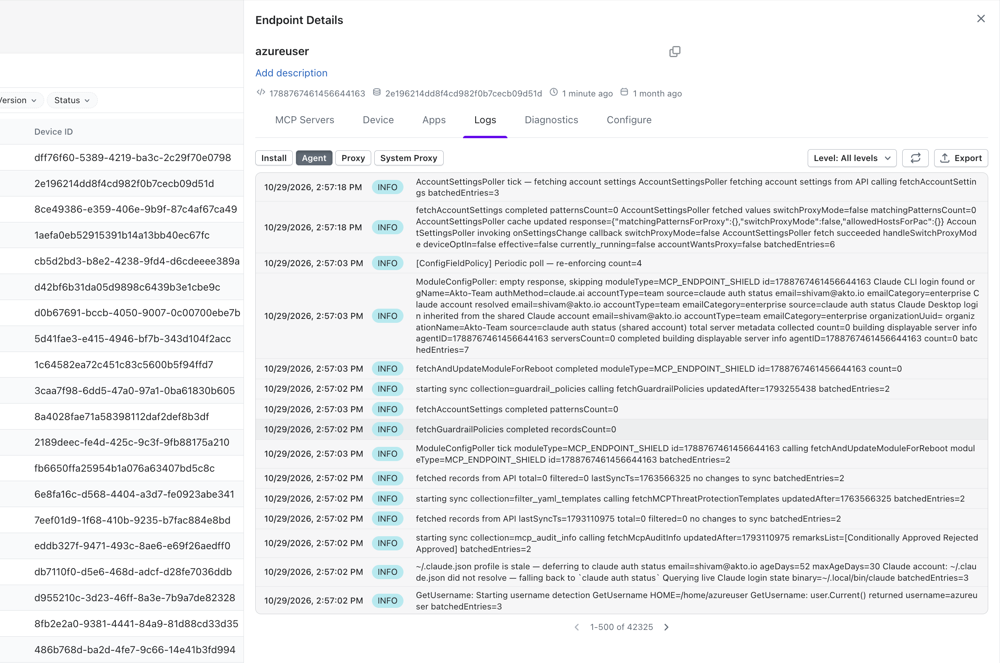
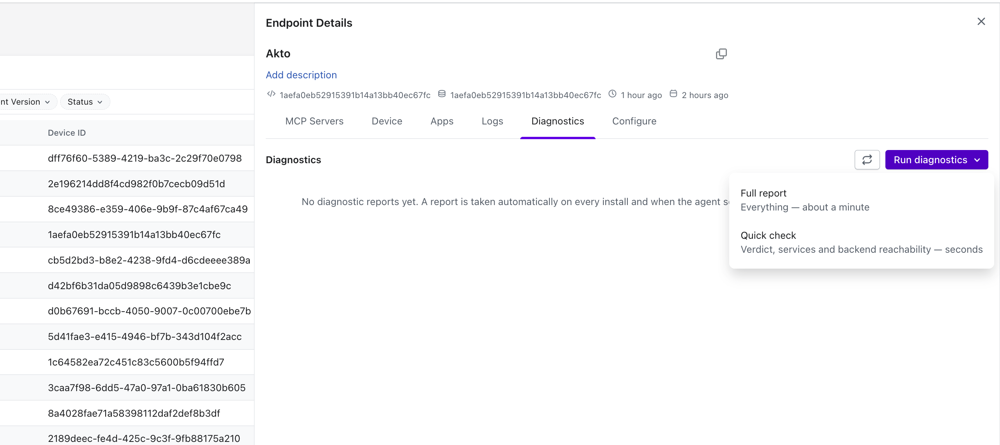
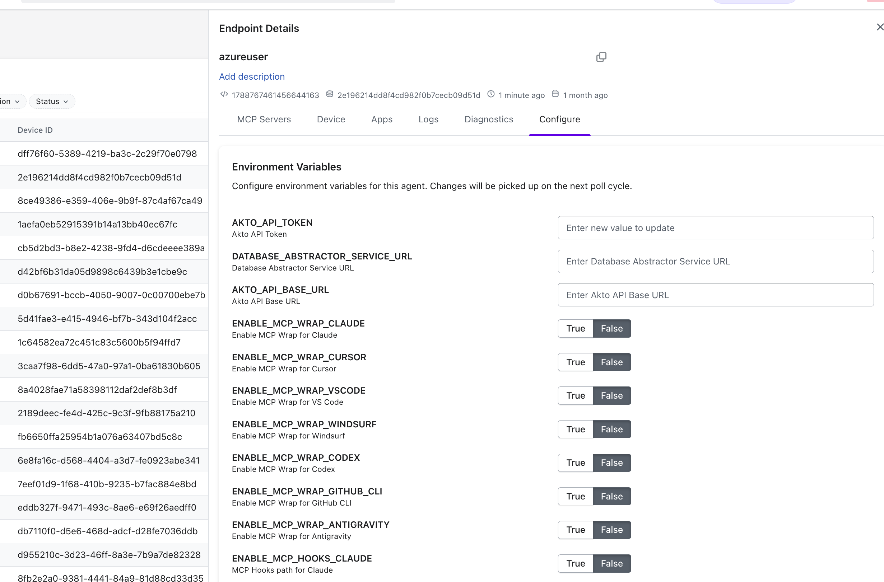

# View Endpoint Shield Details

## Overview

The Endpoint Shield page shows you every protected endpoint and gives you a clear view of agent activity, deployment status, and shielded MCP servers.

## Accessing Endpoint Shield

Navigate to **Agentic Discovery ->** **Endpoint Shield** in the left sidebar to view your complete agent inventory across all employee devices.

## Agent List

The Agent List displays all endpoints where the shield is active. The search box shows the total agent count (for example, **Search in 150 agents**) and matches against the list. The **All time** control at the top right sets the time range for the page.

### Filter the Agent List

Use the filter chips below the search box to narrow the list by **Username**, **Hostname**, **Device ID**, **OS/Browser**, **Agent Version**, or **Status**. The sort button at the right of the search box changes the row order.

### Agent List columns

Each row contains:

| Column             | Description                                                                |
| ------------------ | -------------------------------------------------------------------------- |
| **Status**         | Health indicator of the shield on the endpoint.                            |
| **Hostname**       | Hostname of the machine where the shield is deployed.                      |
| **Device ID**      | Device identifier of the machine where the shield is deployed.             |
| **Agent Version**  | Version of the shield running on the endpoint (for example, `v1.1.94`).    |
| **OS/Browser**     | Operating system or browser of the endpoint (for example, macOS).          |
| **Username**       | User associated with the device on which the shield is installed.          |
| **Last Heartbeat** | Date of the most recent health check sent by the agent. Sortable column.   |
| **Last Deployed**  | Date when the latest shield configuration was deployed to the endpoint.    |

<figure><figcaption></figcaption></figure>

You can select an endpoint to view deeper information.

## Take Bulk Actions

Select multiple endpoints in the Agent List to apply an action to all of them at once.

* **Enable or disable the system proxy**: Turn the [Akto System Proxy](../endpoints-discovery-agents/akto-system-proxy.md) on or off across the selected endpoints.
* **Turn on automatic updates**: Enable automatic updates for the shield on the selected endpoints.

## Endpoint Details Flyout

Selecting an endpoint opens the **Endpoint Details** flyout. The header shows the endpoint's username with a copy button, an **Add description** link for attaching a note to the endpoint, and the endpoint's identifiers (including the Device ID) and two relative times (for example, **1 minute ago**). Close the flyout with the **X** at the top right.

The flyout has six tabs: **MCP Servers**, **Device**, **Apps**, **Logs**, **Diagnostics**, and **Configure**.

### MCP Servers

The **MCP Servers** tab lists the MCP servers that the shield discovered on the selected endpoint. You can review each server's name and the URL or command that the endpoint uses to run it. Each row contains:

| Column                  | Description                                                                                                                                  |
| ----------------------- | -------------------------------------------------------------------------------------------------------------------------------------------- |
| **Server Name**         | Name of the MCP server. When the server comes from a client config file, the file path appears in brackets (for example, `[~/.config/gh/mcp.json]`). |
| **Endpoint / Command**  | URL or command that starts the MCP server. Authorization header values appear as `***MASKED***`. The cell is empty when no value was reported. |
| **Last Updated**        | Date when the server entry was last updated, or **Never**.                                                                                   |

The list is paginated. Use the arrows to move between pages and **Show 50** to change the number of rows per page.

<figure><figcaption>Review the MCP servers and the endpoints or commands found on the endpoint.</figcaption></figure>

### Device

The **Device** tab shows the hardware, operating system, network, user, and shield details that the agent reports for the selected endpoint. You can use it to confirm which machine a shield runs on and which shield version is installed. Fields are grouped into the following sections:

| Section                | Fields                                                                                              |
| ---------------------- | --------------------------------------------------------------------------------------------------- |
| **Hardware**           | **CPU Model**, **Architecture**, **RAM**, **Total Disk**, **Free Disk**, **CPU Cores**, **Virtual Machine** |
| **Operating System**   | **OS**, **OS Version**, **Kernel**, **Last Boot**, **Locale**                                       |
| **Network**            | **Public IP**, **Local IP**, **Hostname**                                                           |
| **User**               | **Full Name**, **Username**, **Shell**                                                              |
| **Agent**              | **Shield Version**, **First Seen**                                                                  |

<figure><figcaption>Review the hardware, OS, network, user, and shield details reported for the endpoint.</figcaption></figure>

### Apps

The **Apps** tab lists the applications that the shield found installed on the selected endpoint, including AI tools such as Cursor, Claude, and GitHub Copilot. You can use it to see which tools and versions run on the device. Each row contains:

| Column        | Description                                                                          |
| ------------- | ------------------------------------------------------------------------------------ |
| **App Name**  | Name of the installed application.                                                   |
| **Version**   | Installed version of the application. A dash appears when no version was reported.   |

<figure><figcaption>Review the applications and versions installed on the endpoint.</figcaption></figure>

### Logs

The **Logs** tab shows the shield's log entries for the selected endpoint, newest first. You can use it to check when the agent last synced, which policies and settings it fetched, and how enforcement behaved on the endpoint. Each entry shows a timestamp, a level badge (for example, **INFO**), and the log message.

Use the controls above the log list to narrow and export entries:

| Control                 | Description                                                                              |
| ----------------------- | ---------------------------------------------------------------------------------------- |
| **Install**             | Shows log entries from the shield installation.                                          |
| **Agent**               | Shows log entries from the shield agent. Selected by default.                            |
| **Proxy**               | Shows log entries from the proxy.                                                        |
| **System Proxy**        | Shows log entries from the [Akto System Proxy](../endpoints-discovery-agents/akto-system-proxy.md). |
| **Level: All levels**   | Filters entries by log level.                                                            |
| Refresh button          | Reloads the log entries.                                                                 |
| **Export**              | Exports the log entries.                                                                 |

The list is paginated, and the pager shows the current range and total (for example, **1-500 of 42325**).

<figure><figcaption>Select a log source, filter by level, and review the agent's log entries.</figcaption></figure>

### Diagnostics

The **Diagnostics** tab shows diagnostic reports for the selected endpoint. The agent takes a report automatically on every install. Until a report exists, the tab shows **No diagnostic reports yet**. The refresh button reloads the list of reports.

Select **Run diagnostics** to take a report on demand. The menu offers two report types:

| Report           | Description                                                          |
| ---------------- | -------------------------------------------------------------------- |
| **Full report**  | Collects everything. Takes about a minute.                           |
| **Quick check**  | Returns a verdict, service status, and backend reachability. Takes seconds. |

<figure><figcaption>Select Run diagnostics, then choose Full report or Quick check.</figcaption></figure>

### Configure

The **Configure** tab lists the environment variables for the selected endpoint's agent. The agent applies changes on its next poll cycle. Variables are grouped as follows:

**Connection**

| Variable                            | Description                  |
| ----------------------------------- | ---------------------------- |
| `AKTO_API_TOKEN`                    | Akto API Token               |
| `DATABASE_ABSTRACTOR_SERVICE_URL`   | Database Abstractor Service URL |
| `AKTO_API_BASE_URL`                 | Akto API Base URL            |

The connection variables are text fields. For `AKTO_API_TOKEN`, the field prompts **Enter new value to update**.

**MCP wrap**

Each `ENABLE_MCP_WRAP_*` variable has a **True** or **False** selector that turns MCP Wrap on or off for one client.

| Variable                          | Description                       |
| --------------------------------- | --------------------------------- |
| `ENABLE_MCP_WRAP_CLAUDE`          | Enable MCP Wrap for Claude        |
| `ENABLE_MCP_WRAP_CURSOR`          | Enable MCP Wrap for Cursor        |
| `ENABLE_MCP_WRAP_VSCODE`          | Enable MCP Wrap for VS Code       |
| `ENABLE_MCP_WRAP_WINDSURF`        | Enable MCP Wrap for Windsurf      |
| `ENABLE_MCP_WRAP_CODEX`           | Enable MCP Wrap for Codex         |
| `ENABLE_MCP_WRAP_GITHUB_CLI`      | Enable MCP Wrap for GitHub CLI    |
| `ENABLE_MCP_WRAP_ANTIGRAVITY`     | Enable MCP Wrap for Antigravity   |

**MCP hooks**

| Variable                        | Description                       |
| ------------------------------- | --------------------------------- |
| `ENABLE_MCP_HOOKS_CLAUDE`       | MCP Hooks path for Claude         |
| `ENABLE_MCP_HOOKS_CURSOR`       | MCP Hooks path for Cursor         |
| `ENABLE_MCP_HOOKS_CODEX`        | MCP Hooks path for Codex          |
| `ENABLE_MCP_HOOKS_GITHUB_CLI`   | MCP Hooks path for GitHub CLI     |

**Prompt hooks**

| Variable                          | Description                         |
| --------------------------------- | ----------------------------------- |
| `ENABLE_PROMPT_HOOKS_CLAUDE`      | Prompt Hooks path for Claude        |
| `ENABLE_PROMPT_HOOKS_CURSOR`      | Prompt Hooks path for Cursor        |
| `ENABLE_PROMPT_HOOKS_GEMINI`      | Prompt Hooks path for Gemini        |
| `ENABLE_PROMPT_HOOKS_CODEX`       | Prompt Hooks path for Codex         |
| `ENABLE_PROMPT_HOOKS_GITHUB_CLI`  | Prompt Hooks path for GitHub CLI    |

**Settings config scans**

| Variable                                      | Description                       |
| --------------------------------------------- | --------------------------------- |
| `ENABLE_CLAUDE_SETTINGS_CONFIG_SCAN`          | Claude Settings Config            |
| `ENABLE_CLAUDE_DESKTOP_SETTINGS_CONFIG_SCAN`  | Claude Desktop Settings Config    |
| `ENABLE_CODEX_SETTINGS_CONFIG_SCAN`           | Codex Settings Config             |
| `ENABLE_COPILOT_CLI_SETTINGS_CONFIG_SCAN`     | Copilot CLI Settings Config       |

**Proxy and updates**

| Variable                    | Description                                                                                          |
| --------------------------- | ---------------------------------------------------------------------------------------------------- |
| `ENABLE_SYSTEM_PROXY`       | Enable System Proxy. See [Akto System Proxy](../endpoints-discovery-agents/akto-system-proxy.md).   |
| `ENABLE_AUTO_UPDATE`        | Enable Auto Update                                                                                   |
| `UPDATE_TO_LATEST_VERSION`  | Update To Latest Version                                                                             |

<figure><figcaption>Review or change the agent's environment variables for the selected endpoint.</figcaption></figure>

## Learn More

To understand how Endpoint Shield works at a conceptual level, including architecture, workflow, and protection mechanics, refer to the [**AI Endpoint Shield**](https://docs.akto.io/ai-endpoint-shield)**.**
