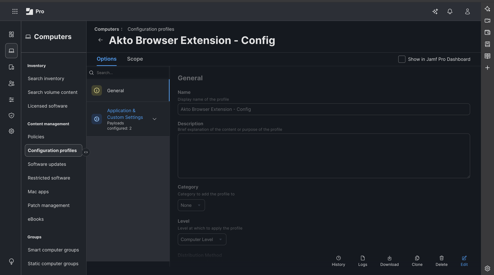
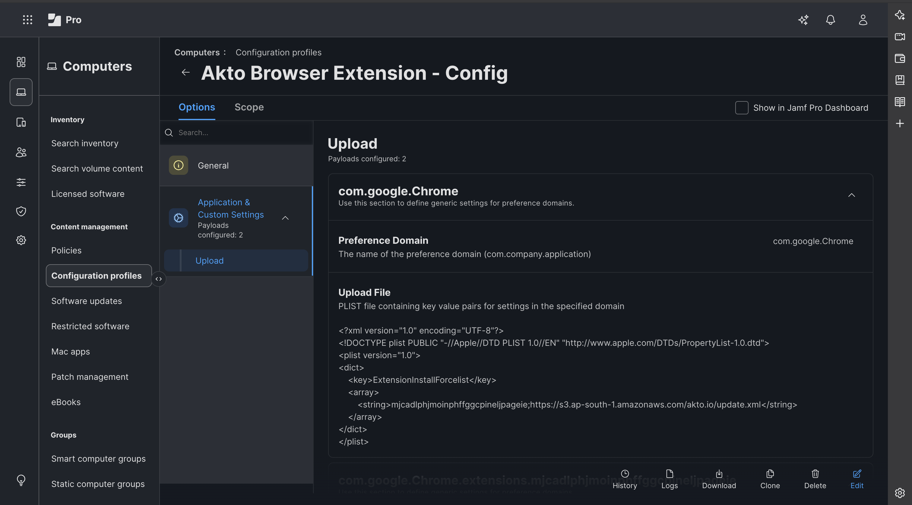
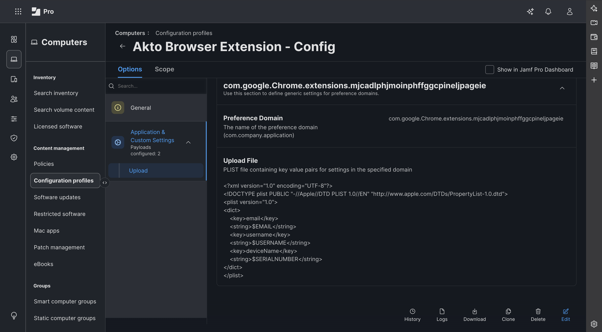

# Jamf Deployment (macOS)

Deploy the Akto Security Chrome extension to macOS devices managed by Jamf Pro using a Configuration Profile with Application & Custom Settings payloads.

## Overview

This method force-installs the extension for managed Macs and keeps it controlled by policy. The same profile can also push the user and device identity the extension reports to Akto.

Akto provides the required values:

* **Extension ID**
* **Update XML URL**


Use the values exactly as shared by Akto Support. Do not modify the extension ID or update URL format.


## Prerequisites

* Jamf Pro admin access
* Target Macs enrolled in Jamf Pro (MDM-managed)
* Google Chrome installed on target devices
* Akto-provided extension details:
  * Extension ID (example format: `xxxxxxxxxxxxxxxxxxxxxxxxxxxxxxxx`)
  * Update XML URL (example format: `https://.../update.xml`)


Chrome on macOS only force-installs extensions hosted outside the Chrome Web Store when the policy is delivered by MDM. Create the profile at **Computer Level**, not User Level.


<details>

<summary><strong>Create Jamf Configuration Profile (force-install steps)</strong></summary>



**Create a New Configuration Profile**

1. Sign in to Jamf Pro.
2. Navigate to **Computers → Configuration profiles**.
3. Click **New**.
4. Under **General**, set:
   * **Name:** for example, `Akto Browser Extension - Config`
   * **Level:** `Computer Level`

<div data-with-frame="true"><figure><figcaption><p>Name the profile and set the level to Computer Level.</p></figcaption></figure></div>



**Add the Force-Install Payload**

1. In the payload list, select **Application & Custom Settings → Upload**.
2. Click **Add**.
3. Set **Preference Domain** to:

```
com.google.Chrome
```

4. Paste this property list, replacing the placeholders with the Akto-provided values:

```xml
<?xml version="1.0" encoding="UTF-8"?>
<!DOCTYPE plist PUBLIC "-//Apple//DTD PLIST 1.0//EN" "http://www.apple.com/DTDs/PropertyList-1.0.dtd">
<plist version="1.0">
<dict>
    <key>ExtensionInstallForcelist</key>
    <array>
        <string><AKTO_EXTENSION_ID>;<AKTO_UPDATE_XML_URL></string>
    </array>
</dict>
</plist>
```

Example entry:

```
mjcadlphjmoinphffggcpineljpageie;https://akto-chrome-ext.s3.ap-south-1.amazonaws.com/akto-chrome-ext/update.xml
```


The `<?xml ...?>` line must be the very first line of the property list, with no leading spaces or blank lines.


<div data-with-frame="true"><figure><figcaption><p>Add the Akto extension ID and update XML URL under the com.google.Chrome domain.</p></figcaption></figure></div>



**Add the Identity Payload (Recommended)**

This payload tells the extension who the user and device are, so activity is attributed correctly even when Chrome is signed out or signed in with a personal account. See [Custom Device Name and Email](../../device-identity.md) for how the extension uses these keys.

1. In the same **Upload** section, click **Add** again.
2. Set **Preference Domain** to:

```
com.google.Chrome.extensions.<AKTO_EXTENSION_ID>
```

Example:

```
com.google.Chrome.extensions.mjcadlphjmoinphffggcpineljpageie
```

3. Paste this property list:

```xml
<?xml version="1.0" encoding="UTF-8"?>
<!DOCTYPE plist PUBLIC "-//Apple//DTD PLIST 1.0//EN" "http://www.apple.com/DTDs/PropertyList-1.0.dtd">
<plist version="1.0">
<dict>
    <key>email</key>
    <string>$EMAIL</string>
    <key>username</key>
    <string>$USERNAME</string>
    <key>deviceName</key>
    <string>$SERIALNUMBER</string>
</dict>
</plist>
```

Jamf Pro replaces these variables with each computer's inventory values:

| Variable        | Source in Jamf Pro                                                  |
| --------------- | ------------------------------------------------------------------- |
| `$EMAIL`        | Computer record → **Inventory → User and Location → Email Address** |
| `$USERNAME`     | Computer record → **Inventory → User and Location → Username**      |
| `$SERIALNUMBER` | Hardware inventory (populated automatically)                        |


`$EMAIL` and `$USERNAME` are only filled in when **User and Location** is populated for the computer, for example through a Cloud Identity Provider or LDAP integration, enrollment authentication, or `sudo jamf recon -endUsername <user> -email <email>`. Leave `deviceName` as `$SERIALNUMBER`: it is stable and unique, unlike the computer name.


<div data-with-frame="true"><figure><figcaption><p>Push email, username, and device name to the extension's managed preference domain.</p></figcaption></figure></div>



**Scope and Save the Profile**

1. Open the **Scope** tab.
2. Add the target computers or computer groups. Start with a small test group.
3. Click **Save**.



</details>

## Validate Deployment



**Check the profile in Jamf Pro**

Open the profile and check **Logs** to confirm it was installed on the target computers.



**Check the profile on a target Mac**

Confirm the profile is listed in **System Settings → Privacy & Security → Profiles**.



**Check the managed preference domains**

In Terminal, confirm both managed preference domains are present:

```bash
defaults read "/Library/Managed Preferences/com.google.Chrome"
defaults read "/Library/Managed Preferences/com.google.Chrome.extensions.mjcadlphjmoinphffggcpineljpageie"
```



**Verify policies in Chrome**

Open `chrome://policy`, click **Reload policies**, and verify:

* `ExtensionInstallForcelist` shows status **OK**.
* The extension's section shows real values for `email`, `username`, and `deviceName`, not `$EMAIL` or other unexpanded variables.



**Confirm the extension is installed**

Open `chrome://extensions` and confirm **Akto Security** is listed as installed by your organisation.



**Confirm activity in Akto**

Confirm activity is visible in Akto after users browse monitored domains.



## Troubleshooting

* **Extension not installed:** Verify the value format is exactly `<extension_id>;<update_xml_url>`, and that the update XML URL opens in a browser.
* **Policy not shown in `chrome://policy`:** Confirm the profile is set to **Computer Level** and installed on the Mac, then restart Chrome.
* **Identity fields empty or show `$EMAIL`:** Populate **User and Location** for the computer in Jamf Pro and redeploy the profile.
* **No Akto traffic visible:** Confirm Browser Extension scope is configured in Akto Settings and target domains match.

## Support

For extension ID/update URL issues or deployment help, contact [**support@akto.io**](mailto:support@akto.io).
