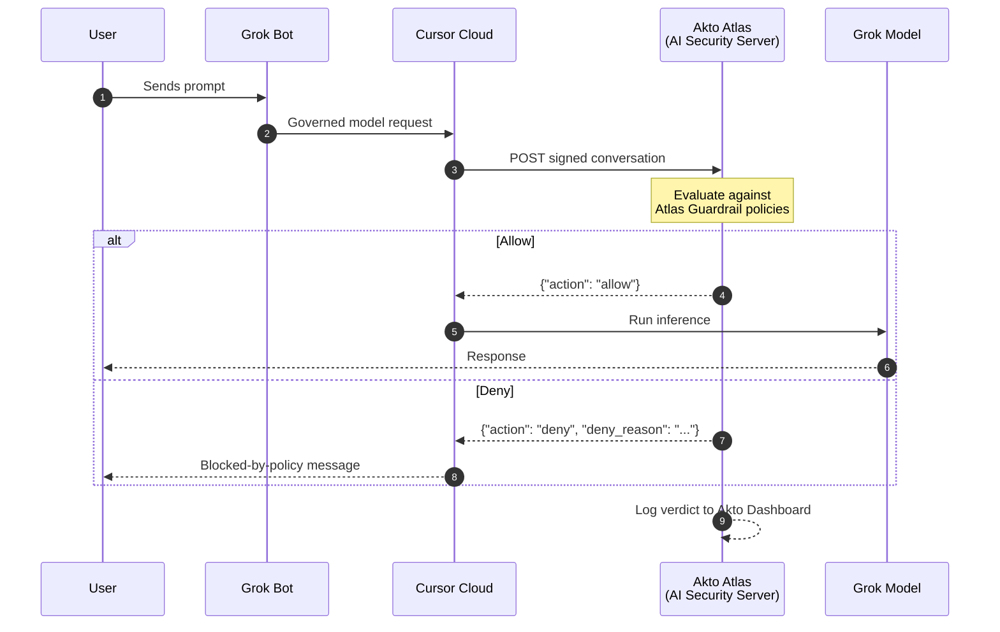

# Grok Bot Inference Hooks

## Overview

Grok Bot is xAI's desktop and mobile assistant, delivered through Cursor. The app on the laptop is a thin client: model calls, shell, browser, and MCP tools run on a per-user cloud VM, and the device only talks to Cursor-owned domains that must bypass TLS inspection. That means an endpoint agent or proxy on the device cannot read Grok Bot prompts.

[Inference Hooks](https://docs.x.ai/grok-bot/inference-hooks) is the supported control point. An admin sets an endpoint URL in the Cursor dashboard, and Cursor sends every governed model request to that URL and waits for an **allow** or **deny** verdict before inference runs.

Akto Atlas can act as that AI security server. Point your organization's Inference Hooks configuration at Akto, and every governed Grok Bot prompt is evaluated against your **Atlas Guardrail policies** inline, with no endpoint agent, browser extension, or IDE hook required.

## How It Works

1. A user sends a prompt in Grok Bot.
2. Cursor sends an HTTPS `POST` containing the conversation so far to Akto's verdict endpoint, signed per the [Standard Webhooks](https://www.standardwebhooks.com/) spec, with the custom `Authorization` header you configured so Atlas can identify your account.
3. Atlas evaluates the conversation against your configured Guardrail policies and returns a verdict within your Verdict Timeout (5 seconds by default).
4. On `allow`, inference proceeds normally. On `deny`, Cursor can block the request and show the user your Blocked Message plus Atlas's per-request reason, depending on the enforcement mode you chose. The decision is logged to your Akto dashboard either way.



## Enforcement Modes

Cursor controls what a verdict does, through the **Enforce Verdicts** setting and the **Mode** you pick:

| Mode | A deny verdict | If the check fails or times out |
|---|---|---|
| Shadow (default) | Logged only, the request proceeds | Request proceeds |
| Allow the Request | Request is blocked | Request proceeds uninspected |
| Block the Request | Request is blocked | Request is blocked |

Start in Shadow mode to see what Atlas would have denied, then move to Allow or Block once you are happy with the policies.

## What Atlas Evaluates

Every conversation Cursor forwards is scored against the same Guardrail policies Atlas already enforces at the endpoint. See [Agent Guard](../../agentic-guardrails/concepts/agent-guard.md) for the full scanner list. Typical uses of the hook:

* **Sensitive data exposure**: PII, secrets, source code, or other regulated data in the prompt
* **Unsafe prompts and jailbreaks**: prompt injection or jailbreak patterns
* **Compliance archival**: always return `allow` and use the conversation purely to record activity in real time

## What Atlas Can and Cannot See

Cursor forwards the full conversation so far on each request: text, tool calls and their results, and text extracted from attachments. Images are sent as metadata only, not bytes or URLs.

Keep these limits in mind:

* **Only allow or deny.** There is no redact or modify verdict.
* **Model responses are not sent.** Only inputs to the model are checked.
* **Tool calls appear after they have run.** A deny stops the next model call, not the tool action that already happened.
* **Not every call is governed.** Cursor does not call the hook for chat titles or memory saves.

## Prerequisites

* Grok Bot with Inference Hooks enabled (Cursor Enterprise, currently in beta)
* A Cursor dashboard admin who can edit **Grok Bot → Security & Compliance → Inference Hooks**
* An **Akto Atlas** account with the Connectors section accessible

## Setting It Up

Akto exposes a dedicated webhook endpoint for Grok Bot Inference Hooks, scoped to your Akto account:

```
https://<your-account-id>-guardrails.akto.io/api/v1/webhooks/grokbot/guardrail
```

In the Cursor dashboard, open **Grok Bot → Security & Compliance → Inference Hooks** and:

1. Set the endpoint URL to the address above. It must be public HTTPS on port 443 with a certificate from a public CA.
2. Add a custom header named **`Authorization`** with your **database abstractor token**, the same API token used by your other Akto connectors. Get it from **Connectors → Setup Guardrail** in your Akto Atlas dashboard.
3. Keep the Verdict Timeout at the 5 second default, or set it between 1 and 10,000 ms.
4. Use **Test Connection**. Atlas answers the test request with an `allow` verdict.
5. Choose Shadow mode first, then switch the mode once you have reviewed the activity.


**Contact the Akto team** to set this up, via in-app Intercom support or [support@akto.io](mailto:support@akto.io). They'll confirm your account's webhook URL and token, and walk you through registering them in the Cursor dashboard.


## What You'll See in Akto

* **Atlas Guardrails → Guardrail Activity**: every verdict Atlas returned (allow or deny, the policy that fired, and the conversation context), alongside guardrail events from your other endpoints
* **Agentic AI Discovery → Agentic Assets**: governed Grok Bot usage grouped under a **Grok Bot** agent

Grok Bot does not send the user's email address, only an opaque actor ID. Activity is therefore attributed to that ID, shown in a collection named `inference-hook-<actor-id>.ai-agent.grok-bot`.

## Related Pages

* [Claude Inference Hooks](claude-inference-hooks.md): the same webhook for Anthropic's Claude Enterprise.

## Get Support for your Akto setup

There are multiple ways to request support from Akto. We are 24X7 available on the following:

1. In-app `intercom` support. Message us with your query on intercom in Akto dashboard and someone will reply.
2. Join our [discord channel](https://www.akto.io/community) for community support.
3. Contact `support@akto.io` for email support.
4. Contact us [here](https://www.akto.io/contact-us).
