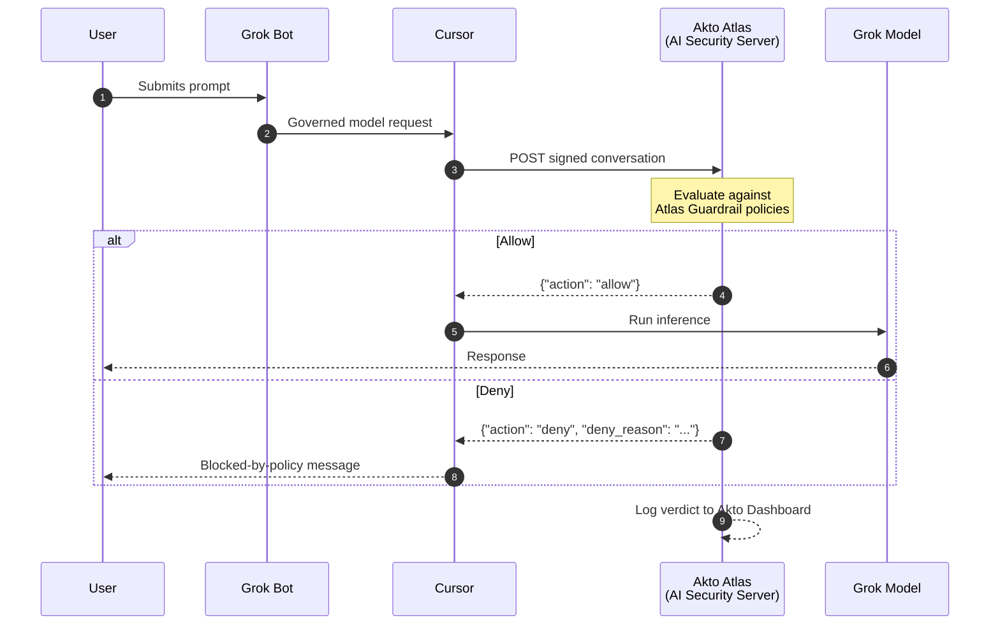

# Grok Bot Inference Hooks (Beta)

## Overview

[Inference Hooks](https://docs.x.ai/grok-bot/inference-hooks) is a Grok Bot feature for Cursor Enterprise teams that routes every governed model request through an organization's own **AI security server**, an HTTPS endpoint that returns an allow or deny verdict, before inference runs. A denied request never reaches the model.

Akto Atlas can act as that AI security server. Point your team's Inference Hooks configuration at Akto, and every governed Grok Bot prompt is evaluated against your **Atlas Guardrail policies** inline, before the model ever sees it, with no endpoint agent, browser extension, or IDE hook required.

Grok Bot runs its model calls on a per-user cloud VM, so an endpoint agent or proxy on the device cannot read its prompts. Inference Hooks gives you enforcement in the critical path.

## How It Works

1. A user sends a prompt in Grok Bot.
2. Cursor sends an HTTPS `POST` containing the conversation so far to Akto's verdict endpoint, signed per the [Standard Webhooks](https://www.standardwebhooks.com/) spec, and carrying an `Authorization` header with your Akto token so Atlas can identify your account.
3. Atlas evaluates the conversation against your configured Guardrail policies and returns a verdict within your team's verdict timeout (5 seconds by default).
4. On `allow`, inference proceeds normally. On `deny`, Cursor blocks the request and shows the user a policy message built from Atlas's per-request reason, when the enforcement mode allows blocking. The decision is logged to your Akto dashboard either way.



Today the only hook event is `prompt`, firing before each model call. Model responses are not checked.

Cursor's enforcement mode decides what a deny does: **Shadow Mode** (default) only logs it, **Allow the Request** blocks denied requests and lets requests through if the check fails, and **Block the Request** blocks both. Start in Shadow Mode and switch once you are happy with the policies.

## What Atlas Evaluates

Every conversation Cursor forwards is scored against the same Guardrail policies Atlas already enforces at the endpoint. See [Agent Guard](../../agentic-guardrails/concepts/agent-guard.md) for the full scanner list. Typical uses of the hook:

* **Sensitive data exposure**: PII, secrets, source code, or other regulated data in the prompt
* **Unsafe prompts and jailbreaks**: prompt injection or jailbreak patterns
* **Compliance archival**: always return `allow` and use the conversation purely to archive activity in real time

## What Atlas Can and Cannot See

Cursor forwards the full conversation so far on each request: text, tool calls and their results, and text extracted from attachments. It never forwards system prompts, tool definitions, or hidden reasoning, and images arrive as metadata only (media type and size, not bytes or URLs), so image-only content cannot be inspected or blocked on this path. Tool calls appear only after they have run, so a deny stops the next model call, not an action already taken.

## Prerequisites

* A **Cursor Enterprise** team with Grok Bot Inference Hooks enabled (currently in beta)
* A Cursor team admin who can edit the Inference Hooks page in the dashboard
* An **Akto Atlas** account with the Connectors section accessible

## Setting It Up

Akto exposes a dedicated webhook endpoint for Grok Bot Inference Hooks, scoped to your Akto account:

```
https://<your-account-id>-guardrails.akto.io/api/v1/webhooks/grokbot/guardrail
```

Register this URL as your AI security server on the Cursor dashboard's **Inference Hooks** page, and add a custom **`Authorization`** header set to your **database abstractor token**, the same API token used by your other Akto connectors. Get it from **Connectors → Setup Guardrail** in your Akto Atlas dashboard.


**Contact the Akto team** to set this up, via in-app Intercom support or [support@akto.io](mailto:support@akto.io). They'll confirm your account's webhook URL and token, and walk you through registering them in Cursor.


## What You'll See in Akto

* **Atlas Guardrails → Guardrail Activity**: every verdict Atlas returned (allow or deny, the policy that fired, and the full conversation context), alongside guardrail events from your other endpoints
* **Agentic AI Discovery → Agentic Assets**: governed Grok Bot usage under a **Grok Bot** agent. Grok Bot does not send the user's email, so activity is attributed to an opaque actor ID.

See also [Claude Inference Hooks](claude-inference-hooks.md).

## Get Support for your Akto setup

There are multiple ways to request support from Akto. We are 24X7 available on the following:

1. In-app `intercom` support. Message us with your query on intercom in Akto dashboard and someone will reply.
2. Join our [discord channel](https://www.akto.io/community) for community support.
3. Contact `support@akto.io` for email support.
4. Contact us [here](https://www.akto.io/contact-us).
