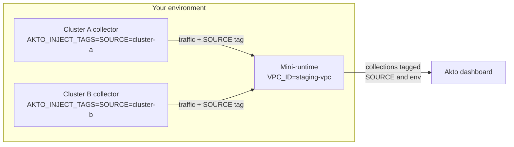

# Set Tags in Akto

If you are tracking and testing multiple environments through Akto, you can **tag** your API collections as **Staging** or **Production**.

It will help you in triaging alerts - for example, urgency for a new Sensitive Data in `Production` vs `Staging` . Similarly, testing shouldn't be done on collections marked as `Production`.

To set tag for an API collection, go to **API Discovery** > **API Collections**. Select any number of API Collections from the table and click on `Set tags`.

Note that collections that have the word `demo` or `staging` in them are already marked as `Staging`.

### Custom Tags

In addition to the default Production and Staging environments, **you can set custom tags** for your API collections in Akto.

This flexibility allows you to better organize and manage your API collections according to your specific deployment stages, testing requirements, or organizational needs. For example, you might want to create environment tags types like 'Development', 'QA', or 'Pre-Production' to match your workflow or maybe data source tags.

<figure><figcaption></figcaption></figure>

### Automated Tags

Instead of tagging collections by hand, you can have Akto tag them automatically. You set a value once when you deploy the traffic collector or the mini-runtime in your environment, and every collection built from that traffic carries the tag.

Traffic flows from the collectors (running in your Kubernetes clusters or VMs) to the mini-runtime, and from the mini-runtime to the Akto dashboard. Both the collectors and the mini-runtime run in your environment, so you decide which tags each one adds.

Automated tags appear next to the collection name as `key=value` chips, for example `SOURCE=payments-cluster` and `env=prod-vpc-1`.



| Where you set it | Environment variable | Tag in Akto |
| --- | --- | --- |
| Mini-runtime | `VPC_ID` | `env` (the environment type of the collection) |
| Traffic collector (tcpdump, eBPF, Kubernetes eBPF) | `AKTO_INJECT_TAGS` | One tag per `key=value` pair you set |

#### Tag by environment (mini-runtime)

Set the `VPC_ID` environment variable on the mini-runtime. Its value becomes the `env` tag on every collection that receives traffic through that mini-runtime.

#### Tag by source (traffic collector)

Set the `AKTO_INJECT_TAGS` environment variable on the traffic collector. Use semicolon-separated `key=value` pairs. Each pair becomes a tag on the collections built from that collector's traffic:

```bash
AKTO_INJECT_TAGS="SOURCE=payments-cluster;team=payments"
```

* Spaces around keys and values are ignored.
* If you repeat a key, the last value is used.
* Entries without a key or without `=` are skipped.
* Only the first `=` splits the pair, so `url=a=b` gives the key `url` and the value `a=b`.

Run each collector with its own value (for example one per cluster) to see where each API collection came from.

Tags are added to a collection, never replaced. If the same API host receives traffic from two collectors that use different values, such as `SOURCE=cluster-a` and `SOURCE=cluster-b`, that collection shows both tags.


Tags are applied to traffic collected after you set the variable. Restart the collector or mini-runtime after changing it.

