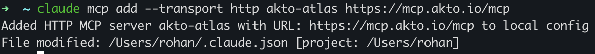
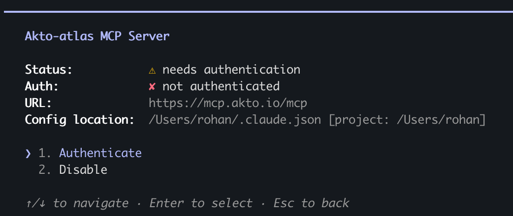
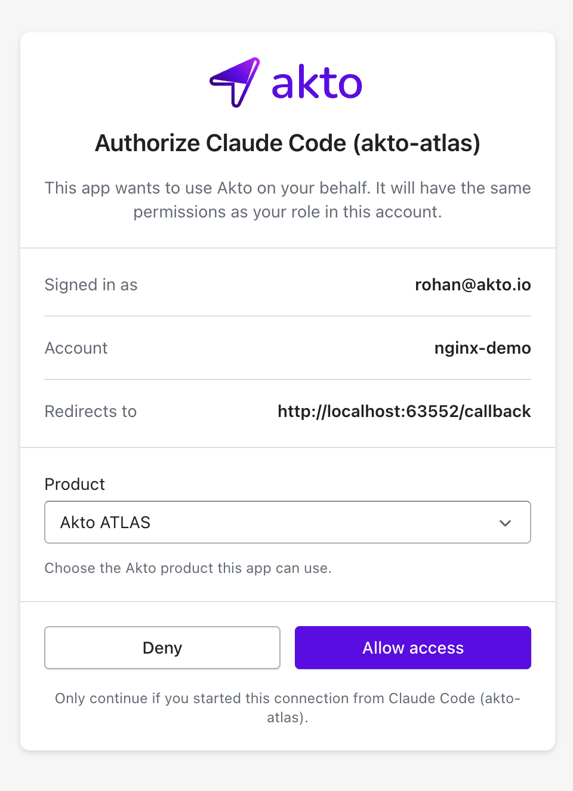
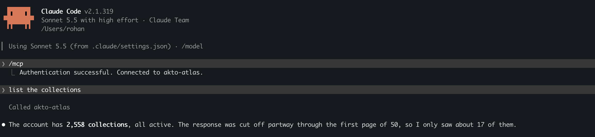
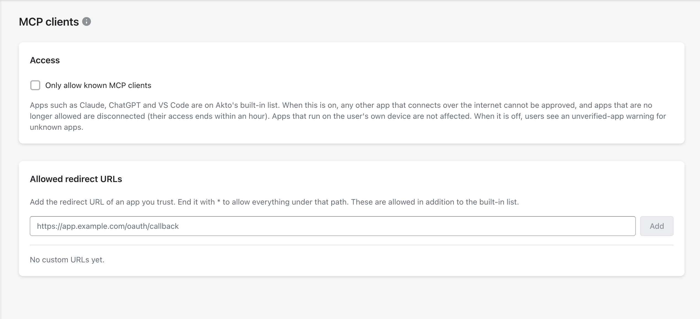

# Access the Public Akto MCP Server

## Overview

Akto hosts a public **MCP (Model Context Protocol) server** that lets any MCP-compatible client (Claude, Cursor, etc.) connect directly to your Akto data, without deploying or self-hosting an MCP server yourself.

The server URL is `https://mcp.akto.io/mcp`. You can connect by signing in to Akto (Claude), or with an Akto API key.


**Akto's MCP server is HTTP-only; `stdio` is not supported.** Configure it as an `http`-type server entry pointing at `https://mcp.akto.io/mcp`, as shown below.

It also supports only the request/response half of MCP's Streamable HTTP transport, not the streaming (`GET`/SSE) half. If your client requires that streaming handshake to connect, it won't work with this server yet; don't assume a connection failure is an auth issue.


## Prerequisites

* An Akto account with access to the product you want to use
* An MCP-compatible client (Claude, Cursor, etc.)

## Connect with Claude

The connection has the same permissions as your role in the account you sign in to.

### Claude Code



**Add the server**

Run this command in your terminal. The name after `add` is a label of your choice, for example `akto-argus` or `akto-atlas`:

```bash
claude mcp add --transport http akto-atlas https://mcp.akto.io/mcp
```

<div data-with-frame="true"><figure><figcaption></figcaption></figure></div>



**Authenticate**

Run `/mcp` in Claude Code, select the server, and choose **Authenticate**.

<div data-with-frame="true"><figure><figcaption></figcaption></figure></div>



**Allow access**

Sign in to Akto, select the **Product**, and click **Allow access**.

<div data-with-frame="true"><figure><figcaption></figcaption></figure></div>



**Start asking questions**

Claude Code confirms the connection, and you can start asking questions about your Akto data.

<div data-with-frame="true"><figure><figcaption></figcaption></figure></div>



### Claude (claude.ai and Desktop)



**Add the connector**

Go to **Settings → Connectors → Add custom connector**, enter `https://mcp.akto.io/mcp` and click **Connect**.



**Allow access**

Sign in to Akto, select the **Product**, and click **Allow access**.




Each connection is tied to one product. To use more than one product, add the server once per product under different names, for example `akto-argus` and `akto-atlas`.


## Connect with an API key



**Generate Your Akto API Key**

1. In your Akto dashboard, go to **Settings → Integrations → Automation → Akto API Token**
2. Click **Generate** to create a new token
3. Copy the token; you'll use it in the next step



**Configure the MCP Server**

Add the following configuration in your MCP client:

```json
"akto-mcp-server": {
  "type": "http",
  "url": "https://mcp.akto.io/mcp",
  "headers": {
    "Authorization": "Bearer <YOUR_AKTO_API_KEY>",
    "x-context-source": "Agentic"
  }
}
```

Replace `<YOUR_AKTO_API_KEY>` with the token generated in the previous step.



The API key can be sent as `Authorization: Bearer <API_KEY>` or `X-API-Key: <API_KEY>`. The `x-mcp-api-key` header is deprecated but still supported.

## The `x-context-source` Header

When you connect with an API key, the `x-context-source` header tells the MCP server which Akto product's data to serve:

| Value      | Product                                                 |
| ---------- | -------------------------------------------------------- |
| `API`      | Akto API Security                                       |
| `Agentic`  | Akto Argus (Agentic AI Security)                        |
| `Endpoint` | Akto Atlas (Agentic AI Security for Employee Endpoints) |
| `DAST`     | Akto DAST                                               |


* If `x-context-source` is **not provided**, the server defaults to **API** context.
* If `x-context-source` is set to anything other than the four values above, the request is rejected with an error.
* When you sign in with Akto, you select the product on the consent page, so this header is not used.


Most MCP clients apply a fixed `headers` block for the life of a server connection, so you can't switch `x-context-source` per question. If your work spans multiple contexts (e.g. both Agentic and Endpoint), add multiple named server entries pointing at the same URL and API key, each with a different `x-context-source`, and enable whichever matches what you're currently working on:

<details>

<summary>Example: configuring multiple context entries</summary>

The wrapper key below (`mcpServers`) may be named `servers` instead, depending on your client. Use whichever key your client's own MCP config expects.

```json
{
  "mcpServers": {
    "akto-mcp-server-argus": {
      "type": "http",
      "url": "https://mcp.akto.io/mcp",
      "headers": {
        "Authorization": "Bearer <YOUR_AKTO_API_KEY>",
        "x-context-source": "Agentic"
      }
    },
    "akto-mcp-server-atlas": {
      "type": "http",
      "url": "https://mcp.akto.io/mcp",
      "headers": {
        "Authorization": "Bearer <YOUR_AKTO_API_KEY>",
        "x-context-source": "Endpoint"
      }
    }
  }
}
```

</details>

## Manage which apps can connect

Admins can control which apps can connect with **Sign in with Akto** in **Settings → MCP clients**:

* **Only allow known MCP clients**: when on, users can't approve apps that Akto doesn't recognize
* **Allowed redirect URLs**: apps using these URLs connect without the unverified-app warning

<div data-with-frame="true"><figure><figcaption></figcaption></figure></div>

## Troubleshooting

* **Check the server is reachable**: `GET https://mcp.akto.io/health` returns a liveness response and doesn't require any headers.
* **Connection fails immediately / handshake never completes**: your client may depend on the streaming (`GET`/SSE) half of Streamable HTTP, which this server doesn't implement yet. See the note above.
* **Claude asks you to authenticate again**: run `/mcp` and choose **Authenticate** to sign in again.
* **401 error with an API key**: the key is missing or invalid. Double-check the token you generated.
* **400 error**: `x-context-source` is set to a value other than `API`, `Agentic`, `Endpoint`, or `DAST`. Fix the value, or omit the header to default to `API`.

## Support

If you need help with the setup:

* **Discord Community**: Join our community at [discord.gg/Wpc6xVME4s](https://discord.gg/Wpc6xVME4s)
* **Email Support**: Contact us at [support@akto.io](mailto:support@akto.io)

Our team is available 24/7 to assist you with setup, troubleshooting, and best practices.
