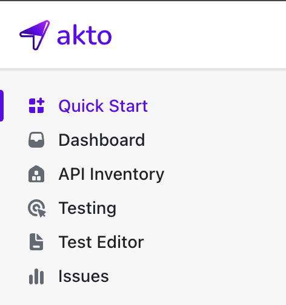
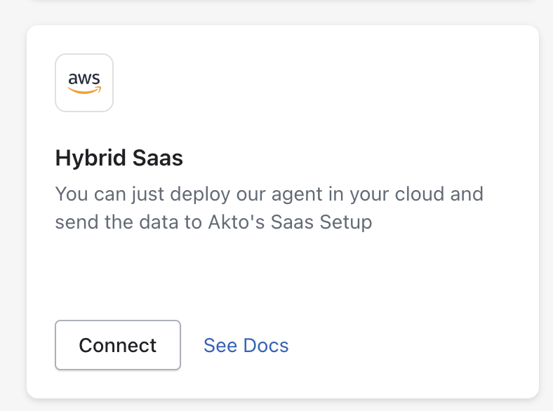
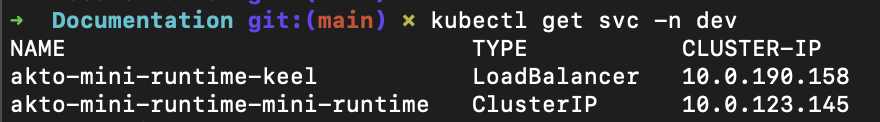
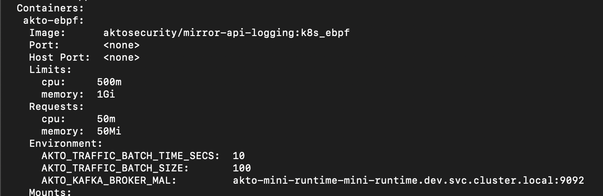

# Connect Akto with Hybrid SaaS

1\. Go to [app.akto.io](https://app.akto.io)

2\. Login/Signup into your account.

3\. Click on Quick Start tab in left nav.

<figure><figcaption></figcaption></figure>

4\. Search for Hybrid SaaS Connector and click connect.

<figure><figcaption></figcaption></figure>

### Installing Traffic connector

You can use either a CloudFormation template, Terraform template, a Helm chart, or an ECS task definition to install Traffic aggregator in your env.

#### Terraform

1. To install using Terraform, use the Terraform script [here](https://github.com/akto-api-security/infra/blob/quick-setup-1.0.0/templates/terraform-aws/mini-runtime-v2/mini-runtime.tf).
   1. Please make sure you install it in a private subnet from your application VPC.
   2. This private subnet should also have network connectivity (typically via NAT).
2. Create a `mini-runtime.tfvars` file with the following values:

   ```hcl
   region                  = "<aws-region>"
   key_pair                = "<ec2-key-pair-name>"
   subnet_id               = "<private-subnet-id>"
   database_abstractor_url = "https://cyborg.akto.io"
   cidr_blocks             = ["<cidr-that-sends-traffic-to-akto>"]

   # Token: use ONE of the two options below
   database_abstractor_token_secret_arn = "<secrets-manager-secret-arn>"   # recommended
   # database_abstractor_token          = "<database-abstractor-token>"

   # Optional: prefix for resource names (max 9 characters). Needed only to install more than once in the same account.
   # environment = "<prefix>"
   ```

   1. You can copy the Database Abstractor token from the helm install command in the above screenshot.
   2. Recommended: store the token in AWS Secrets Manager (as plain text, in the same region) and pass its ARN in `database_abstractor_token_secret_arn`. Alternatively, pass the token directly in `database_abstractor_token`.
   3. `cidr_blocks` are the networks that send traffic to Akto.
3. Run:

   ```bash
   terraform init
   terraform apply -var-file=mini-runtime.tfvars
   ```
4. Once complete, copy `akto_nlb_dns` from the output.
5. The next step is to install a traffic connector.
   1. You can use the above copied `akto_nlb_dns` as `AKTO_KAFKA_BROKER_MAL` in your traffic connectors. Note that `AKTO_KAFKA_BROKER_MAL` is inclusive of port (eg `akto-N-.....amazonaws.com:9092`)

#### Terraform (Baked AMI)

Use this if you want to restrict outbound (egress) traffic. The standard template downloads scripts and Docker images at boot from GitHub, Docker Hub and Amazon ECR Public (CloudFront), whose IPs change often and can't be reliably allowlisted. The baked AMI has everything pre-installed, so nothing is downloaded at boot, and egress can be limited to:

* Akto: `52.189.76.62/32`, `13.86.5.76/32`, `130.131.179.40/32`
* Secrets Manager, through a VPC endpoint (the template can create it)
* Your VPC CIDR (added automatically)

1. Send your AWS account ID and region(s) to Akto. We will share the AMI with you.
   1. Optional: copy the AMI into your own account, so your deployment doesn't depend on ours:

      ```bash
      aws ec2 copy-image --region <region> --source-region <region> \
        --source-image-id <shared-ami-id> --name akto-mini-runtime --encrypted
      ```
2. Use the Terraform script [here](https://github.com/akto-api-security/infra/blob/quick-setup-1.0.0/templates/terraform-aws/mini-runtime-baked-ami/mini-runtime.tf). Use a private subnet from your application VPC.
3. Create a `mini-runtime.tfvars` file with the values from the [Terraform](#terraform) section above, plus:

   ```hcl
   ami_id                         = "<ami-id>"
   egress_cidr_blocks             = ["52.189.76.62/32", "13.86.5.76/32", "130.131.179.40/32"]
   create_secretsmanager_endpoint = true   # set to false if your VPC already has a Secrets Manager endpoint
   ```

   The Secrets Manager endpoint is needed only if you use `database_abstractor_token_secret_arn`. The instance reads the token from Secrets Manager at boot. With restricted egress, the public Secrets Manager address is blocked, and AWS doesn't publish its IPs. The endpoint gives Secrets Manager a private IP inside your VPC, which is already allowed.
4. Run `terraform init` and `terraform apply -var-file=mini-runtime.tfvars`, then use `akto_nlb_dns` as `AKTO_KAFKA_BROKER_MAL` (inclusive of port `9092`) in your traffic connectors.


**Limitations**

1. We share the AMI per region. Please send your account ID and region(s). You can copy it into your own account so you don't depend on ours.
2. No auto-updates. Akto and OS updates need a new AMI and a redeploy with the new `ami_id`.
3. The Secrets Manager endpoint uses private DNS, so it applies to the whole VPC. A VPC can have only one, so skip creating it if your VPC already has one. In that case, make sure your endpoint has private DNS enabled, its security group allows HTTPS (443) from the Akto subnet, its endpoint policy allows `secretsmanager:GetSecretValue` on the token secret, and its IPs are covered by your VPC's primary CIDR or `egress_cidr_blocks` (e.g. if it is in a secondary CIDR or a shared VPC).
4. If the Akto backend IPs change, the egress list needs updating.


#### CloudFormation template

1. To install using CloudFormation, run the Cloudformation template [here](https://raw.githubusercontent.com/akto-api-security/infra/feature/quick-setup/templates/mini-runtime.yml).

i) Please make sure you install it in a private subnet from your application VPC.

ii) This private subnet should also have network connectivity (typically via NAT).

2. You can use `https://cyborg.akto.io` as `DatabaseAbstractorUrl` . For `DatabaseAbstractorToken` you can copy it from the helm install command in the above screenshot.
3. Once complete, go to the **Output** section of CloudFormation Stack and copy `AktoNLBIP`.
4. The next step is to install a traffic connector.
   1. You can use the above copied `AktoNLBIP` as `AKTO_KAFKA_BROKER_MAL` in your traffic connectors. Note that `AKTO_KAFKA_BROKER_MAL` is inclusive of port (eg `akto-N-.....amazonaws.com:9092`)

#### CloudFormation template (v2)

Recommended for new installations. Compared to the template above, v2:

* Uses current AWS Lambda runtimes (Node.js 24, Python 3.13) and AWS SDK v3, replacing the deprecated Node.js 16 and Python 3.9.
* Stores `DatabaseAbstractorToken` in AWS Secrets Manager. It is hidden in the CloudFormation console and not written into the EC2 launch template.
* Uses least-privilege IAM permissions, scoped to the resources the stack creates.
* Supports multiple subnets across Availability Zones for higher availability.
* Runs on Amazon Linux 2023, replacing Amazon Linux 2, which has reached end of life.
* Uses gp3 EBS volumes instead of gp2, for better performance at lower cost.
* Enables AWS Systems Manager (SSM) on the instance, so you can connect with Session Manager or install agents with Run Command.

1. To install using CloudFormation, run the Cloudformation template [here](https://raw.githubusercontent.com/akto-api-security/infra/feature/quick-setup/templates/mini-runtime-v2.yml).

i) Please make sure you install it in a private subnet from your application VPC.

ii) This private subnet should also have network connectivity (typically via NAT).

iii) `SubnetId` accepts one or more subnets. Multi-AZ is optional: with a single subnet, the setup works the same as a single-AZ install. To spread Akto across Availability Zones, select one private subnet per Availability Zone, all from the same VPC.

2. You can use `https://cyborg.akto.io` as `DatabaseAbstractorUrl` . For `DatabaseAbstractorToken` you can copy it from the helm install command in the above screenshot.
3. Once complete, go to the **Output** section of CloudFormation Stack and copy `AktoNLBIP`.
4. The next step is to install a traffic connector.
   1. You can use the above copied `AktoNLBIP` as `AKTO_KAFKA_BROKER_MAL` in your traffic connectors. Note that `AKTO_KAFKA_BROKER_MAL` is inclusive of port (eg `akto-N-.....amazonaws.com:9092`)

#### Helm chart

1\. If you have K8s clusters, you can use helm chart to install Traffic aggregator.

2\. Add akto helm repository.

```bash
helm repo add akto https://akto-api-security.github.io/helm-charts/
```

3. Install `akto-mini-runtime` helm chart in your kubernetes cluster.
   1.  Directly using database abstractor token

       ```bash
       helm install akto-mini-runtime akto/akto-mini-runtime -n <your-namespace> --set mini_runtime.aktoApiSecurityRuntime.env.databaseAbstractorToken="<your-database-abstractor-token>"
       ```
   2.  Storing the database abstractor token in a secret

       ```bash
       helm install akto-mini-runtime akto/akto-mini-runtime -n <your-namespace> --set mini_runtime.aktoApiSecurityRuntime.env.useSecretsForDatabaseAbstractorToken=true --set mini_runtime.aktoApiSecurityRuntime.env.databaseAbstractorTokenSecrets.token="<your-database-abstractor-token>"
       ```
   3.  Bring your own secret which has the database abstractor token

       ```bash
       helm install akto-mini-runtime akto/akto-mini-runtime -n <your-namespace> --set mini_runtime.aktoApiSecurityRuntime.env.useSecretsForDatabaseAbstractorToken=true --set mini_runtime.aktoApiSecurityRuntime.env.databaseAbstractorTokenSecrets.existingSecret=<my-secret>
       ```

4\. Running the above commands in your k8s cluster will deploy a new Akto Traffic aggregator service.

5\. Run the below command and copy the `CLUSTER-IP` and `PORT` value for Traffic aggregator service. In the below example it will be `10.0.23.145:9092`. You can also use the kubernetes service ip, which in this case will be `akto-mini-runtime-mini-runtime.dev.svc.cluster.local:9092`

```bash
kubectl get svc -n <namespace>
```

<figure><figcaption></figcaption></figure>

6\. The next step is to install a traffic connector.

1. You can use the above copied `IP:PORT` value as `AKTO_KAFKA_BROKER_MAL` in your traffic connectors. Note that `AKTO_KAFKA_BROKER_MAL` is inclusive of port (eg `10.0.23.145:9092` , `akto-mini-runtime-mini-runtime.dev.svc.cluster.local:9092`)

<figure><figcaption></figcaption></figure>

#### ECS

1. To install mini-runtime and Kafka on Amazon ECS, follow [Deploy mini-runtime and Kafka on ECS](hybrid-saas-ecs.md).
2. Use the load balancer DNS name from that guide as `AKTO_KAFKA_BROKER_MAL` in your traffic connectors. The value includes the port, for example `akto-kafka-a1b2c3.elb.ap-south-1.amazonaws.com:9092`.

### Linux VM

1. Create a new instance with the following requirements
   1. Platform
      1. Linux
   2. Spec
      1. 16 vCPU
      2. 32GB RAM
      3. 40GB Hard disk
      4. Don’t use burstable instances
   3. Network
      1. Private subnet
      2. connectivity to internet (typically via NAT)
      3. connectivity to your staging service
   4. Security groups
      1. Inbound - Open port 9091 (http), 9092 (kafka)
      2. Outbound - Open all
2. SSH into this new instance in your Cloud
3. Run `sudo su -`
4. Install docker and docker-compose.
5. Run the following commands to download setup files -

```
   wget https://raw.githubusercontent.com/akto-api-security/infra/refs/heads/feature/quick-setup/docker-compose-mini-runtime.yml
   wget https://raw.githubusercontent.com/akto-api-security/infra/refs/heads/feature/quick-setup/watchtower.env
   wget https://raw.githubusercontent.com/akto-api-security/infra/refs/heads/feature/quick-setup/docker-mini-runtime.env
   wget https://raw.githubusercontent.com/akto-api-security/infra/refs/heads/feature/quick-setup/docker-threat-detection.env
   wget https://raw.githubusercontent.com/akto-api-security/infra/refs/heads/feature/quick-setup/data-ingestion-docker.env
```

6. Replace `${AKTO_KAFKA_IP}` in  `docker-compose-mini-runtime.yml` with the the `instance-ip`&#x20;
7. Get your token from Quick Start> Hybrid SaaS > Connect > Copy the token that's in `red` color.
8. Replace the value of `DATABASE_ABSTRACTOR_SERVICE_TOKEN` in `docker-mini-runtime.env` with the token. Don't use double quotes. (The new docker takes double-quotes literally as part of the value!)
9. Replace the value of `AKTO_KAFKA_BROKER_URL` with \<instance\_ip>:9092.&#x20;
10. Replace the value of `AKTO_THREAT_PROTECTION_BACKEND_TOKEN` and `DATABASE_ABSTRACTOR_SERVICE_TOKEN` in `docker-threat-detection.env` with the token.
11. Run `docker-compose -f docker-compose-mini-runtime.yml up -d` . If you are using new version of `docker`, you should use `docker compose` instead of `docker-compose`
12. Run `systemctl enable /usr/lib/systemd/system/docker.service` to ensure Docker starts up in case of instance restarts

## How to Set a Custom Mini-Runtime Module Name

In your `docker-compose-mini-runtime.yml` file, add the environment variable `MINI_RUNTIME_NAME` under the `akto-mini-runtime` service.

```yaml
version: '3.8'
services:
  akto-mini-runtime:
    image: public.ecr.aws/aktosecurity/akto-api-security-mini-runtime:latest
    environment:
      DATABASE_ABSTRACTOR_SERVICE_TOKEN: <Paste_token_here>
      MINI_RUNTIME_NAME: <your_mini_runtime_name>
    restart: always
```

Replace `<your_mini_runtime_name>` with the desired module name (e.g., `staging_runtime`, `us_east_1`, `qa_env`).

## Notes:

1. Ensure internet connectivity in Traffic aggregator service.
2. In case of closed network, please whitelist (https://cyborg.akto.io)
3. Ensure that traffic connector is able to connect to Traffic aggregator service
4. Log levels for Akto services can be configured by setting the environment variable `AKTO_LOG_LEVEL`
   * Supported values include `TRACE`, `DEBUG`, `INFO`, `WARN`, `ERROR` and `OFF`.
   * Default log level is set to `WARN`.

## Get Support for your Akto setup

There are multiple ways to request support from Akto. We are 24X7 available on the following:

1. In-app `intercom` support. Message us with your query on intercom in Akto dashboard and someone will reply.
2. Join our [discord channel](https://www.akto.io/community) for community support.
3. Contact `help@akto.io` for email support.
4. Contact us [here](https://www.akto.io/contact-us).
