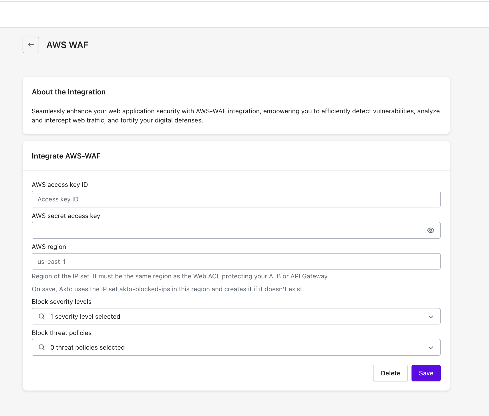

# AWS WAF

Block threat actors detected by Akto using your AWS WAF. Akto adds the IPs you block to an AWS WAF IP set named `akto-blocked-ips`, and a rule in your Web ACL blocks them.

### Prerequisites

* A regional AWS WAF Web ACL attached to your Application Load Balancer or API Gateway.
* An AWS access key with these permissions: `wafv2:ListIPSets`, `wafv2:CreateIPSet`, `wafv2:GetIPSet`, `wafv2:UpdateIPSet`.

### Set up the integration

1. In Akto, go to `Settings` > `Integrations` > `AWS WAF`.
2. Enter your **AWS access key ID**, **AWS secret access key** and the **AWS region** of your Web ACL (for example, `us-east-1`).
3. Click `Save`. Akto creates the IP set `akto-blocked-ips` in that region.

<figure><figcaption></figcaption></figure>

### Add the IP set to your Web ACL

1. In the AWS console, open `WAF & Shield` > `Web ACLs` and open your Web ACL.
2. Click `Add rules` > `Add my own rules and rule groups`.
3. Choose rule type `IP set`, select `akto-blocked-ips`, set the action to `Block`, and save.

### Block threat actors

In `Threat Detection` > `Threat Actors`, select actors and click `Block N IPs` or `Unblock N IPs`. You can also open an actor and click `Block IP` or `Unblock IP`.

### Delete the integration

In `Settings` > `Integrations` > `AWS WAF`, click `Delete`.

## Get Support for your Akto setup

There are multiple ways to request support from Akto. We are 24X7 available on the following:

1. In-app `intercom` support. Message us with your query on intercom in Akto dashboard and someone will reply.
2. Join our [discord channel](https://www.akto.io/community) for community support.
3. Contact `help@akto.io` for email support.
4. Contact us [here](https://www.akto.io/contact-us).
